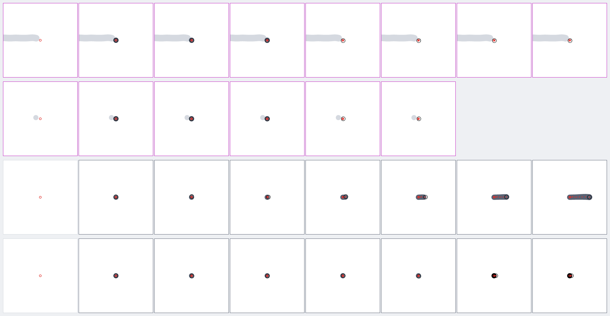
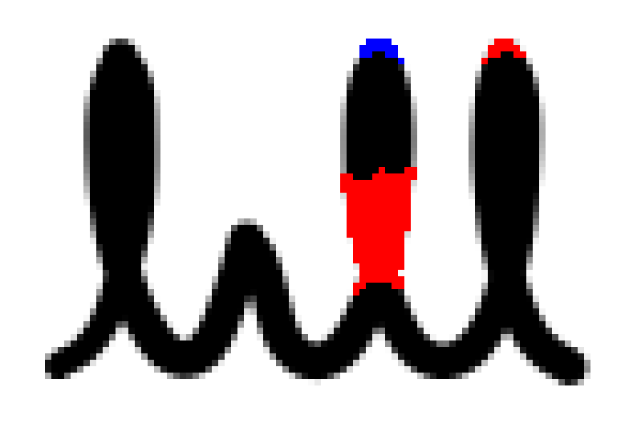
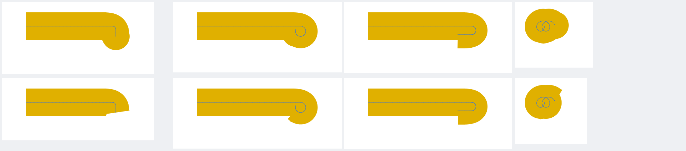

# Ink Lab — pen testing

The Ink Lab measures how Len's ink looks and behaves, not just whether it
draws. It has three parts:

- **Recordings** (`.leninput`): everything the drawing surface received while
  someone wrote. That is every pointer event, every batch of historical stylus
  samples from the Android channel, and every frame boundary with its frame
  timings, in arrival order, plus the pen and view settings
  (`app/lib/ink/lab/`).
- **Replay and metrics**: `ReplayDriver` feeds a recording frame by frame
  through the real pipeline (`InkInputController` with `StylusSampleMerger`,
  `LiveInk`, `SurfaceModel` commit). The suite (`app/test/inklab/`) measures
  each live frame and each committed stroke against what the pen really did.
  Simulated S Pen cases carry an exact ground truth (`sim/`). Real recordings
  use their raw digitiser samples as the truth.
- **The on-device Lab screen**: you write on the real pipeline, see live input
  statistics, then save, share, open and replay recordings.

## Recording on the tablet

1. Open **Settings → About** and tap the version (**Len 0.1.0**) **7 times**.
   The Ink Lab opens. It is a scratch surface: nothing is saved to your
   notebooks or synced.
2. Choose the pen with the pen menu in the app bar: stabiliser 0 / 0.4 / 1 and
   width 1.5 / 2.5 / 4. Stylus-only follows the app's setting; the
   low-latency overlay is on, as in the editor (Android).
3. Write. The bar at the bottom shows:
   - the digitiser rate (Hz) and samples per frame of the latest contact;
   - mean and maximum frame build and raster times (ms);
   - the live-outline build time (ms);
   - sample and contact counts.

   On a Galaxy Tab with S Pen expect about 240 Hz at about 2 samples per frame
   (120 Hz display). About 1 sample per frame means the historical samples are
   not arriving.
4. **Save** (share icon) writes `inklab-<time>.leninput`. Desktop opens a save
   dialog, Android the share sheet (send it to Drive or mail, or save it to
   Files), and the web downloads it. A recording covers everything since the
   last **Clear**, so clear before each take. Keep takes short and focused, e.g.
   one line of cursive, a row of dots, or quick strokes with flicks.
5. **Replay** plays the current recording again in real time through the
   pipeline, with the selected pen (compare stabilisers on the same input).
   **Open** loads a `.leninput` file, switches to its pen and replays it, one
   recorded frame per real frame. The stats bar then shows the recording's own
   frame timings.

## Adding recordings to the suite

Copy the file to `app/test/inklab/recordings/` (any name, `.leninput`). The
suite picks up every file there, at the recorded stabiliser and at
stabiliser 0. With no exact truth, the raw samples are the truth: fidelity
and nub limits get 0.3 px of slack for the jitter in the truth itself.
Contacts shorter than 80 ms that start within 120 ms and 16 px of the last
lift count as bounces, not as intended strokes. Then run the suite. New
failures either point to a regression, or need an entry in
`known_failures.dart` tied to a finding below.

Two simulated recordings are committed as format samples and regression
inputs: `sim_cursive.leninput` and `sim_hooks.leninput`, the `cursive` and
`hooks` cases at the default pen. Replace them with real S Pen takes when
there are some.

## Running

From `app/` (always through `tool/heavy.sh`, one heavy job at a time):

```sh
tool/heavy.sh nix develop ..# -c bash -c 'flutter test --concurrency=4 test/inklab'
# the visual report (≈ 2 min) → build/inklab_report/index.html
tool/heavy.sh nix develop ..# -c bash -c \
  'flutter test test/inklab/report/report_test.dart --dart-define=INKLAB_REPORT=true'
```

`inklab_test.dart` has one test per metric per entry. Entries are the ten
simulated cases at stabiliser 0, 0.4 and 1, plus every recording; the
entries at 0.4 and 1 are judged in `inklab_stabiliser_0_4_test.dart` and
`inklab_stabiliser_1_test.dart`, so the three files run in parallel. Real
device recordings (`recordings/real_*.leninput`, a minute or more of writing
each) take many minutes to replay through the pixel metrics, so they only run
with `--dart-define=INKLAB_REAL=true`:

```sh
tool/heavy.sh nix develop ..# -c bash -c \
  'flutter test --concurrency=4 test/inklab --dart-define=INKLAB_REAL=true'
```

Pen-engine work must pass that run too. Timing metrics only run on
`long_stroke` and recordings; their replays run three times and each frame
keeps its fastest live build and pen-up handling, so load on the machine
does not tip `perf.flatness` (`perf_flatness_test.dart` checks that it
still fails builders doing O(length) work per frame: 6–7× against 1.0×).
The absolute ones (`perf.frameCost`, `perf.commit`) still grow on a machine
busy all through (a full test run beside other work: `perf.commit` 9.5 ms
against ≤ 4 alone), so where the timed replays waited for a CPU or the load
average is high, the suite holds them to 3× their limits (`MachineLoad`,
`judge.dart`); `test/perf/inklab_timing_perf_test.dart` (slow tier) judges
every timing metric strictly.

Flat pen ends (butt caps) have their own rules for the live tip, the
committed ends and the overlay, so `flat_ends_suite_test.dart` (part of
every `flutter test`, ≈ 30 s) judges every metric with the same limits on
flat-ended entries: each simulated case at one stabiliser (0, 0.4 and 1
all covered, where flat ends failed before their rules), the two
simulated recordings, and an excerpt of each
real recording (`excerpt`: a few lines, none of the multi-second ones; the
whole recordings take minutes with flat ends too). Every entry with both
end styles: the table below with `INKLAB_ENDS=both`.

CI (`.github/workflows/ci.yml`) runs `flutter test -x slow` (the suite without
the real recordings, flat entries included). `unit_test.sh`, `check.sh` and
the full table below (real recordings, `INKLAB_ENDS=both`; it fails when
FAILS isn't 0) run locally. Metrics listed in `known_failures.dart` are
**skipped with their finding as the reason**. The list is **empty**: the
engine passes every metric on every entry, real recordings included, so any
failure is a regression (or needs a new finding, with evidence, before an
entry may be added).

Tools for working on the engine (opt-in tests):

```sh
# every metric of every entry as a table (≈ 4 min with the real recordings),
# "!!" marks failures (and the test fails unless FAILS is 0)
tool/heavy.sh nix develop ..# -c bash -c 'flutter test test/inklab/tools/table_test.dart \
  --dart-define=INKLAB_TABLE=true --dart-define=INKLAB_REAL=true \
  [--dart-define=INKLAB_ONLY=<regex on entry names>] \
  [--dart-define=INKLAB_ENDS=flat|both]'
# INKLAB_ENDS writes every entry with flat pen ends (`cursive@0.4/flat`);
# `both` runs the round entries, then the flat ones. Pen-engine and overlay
# work runs `both`: the overlay's flat-end rules only show with flat ends.
# the stabiliser against a shaky hand (F10): committed, live and overlay ink
# at stabiliser 0 / 0.5 / 1, as a table
nix develop ..# -c bash -c 'flutter test test/inklab/stabiliser_test.dart \
  --dart-define=INKLAB_TABLE=true'
# the Kotlin overlay model against the Dart one (needs only nix): every case
# and recording, then the Kotlin unit tests (shared golden; prediction replay)
tool/wet_ink_check/check.sh
tool/wet_ink_check/unit_test.sh
```

`pressure_response_test.dart` (part of the suite, ≈ 10 s) checks the pen's
answer to real S Pen pressure (F11), `erase_stability_test.dart` (≈ 45 s)
that the pixel eraser leaves the rest of a stroke where it was, on every
recording, real ones included (F12).

The report has, per entry:
- the metrics table: ok / known / FAIL, and where (logical px) the worst value
  is;
- **final ink at 1x**: plain, then marked;
- **final ink at 4x and 16x**: around the worst spot of the most telling
  failing metric, zoom × device pixel ratio, so 1x is what the screen shows.
  Grey is ink, green the true path, red dots the raw samples, blue the
  smoothed centre line;
- a **filmstrip** of live frames: the 4 frames with the most change behind the
  tip plus evenly spread ones, then the committed stroke. Red marks pixels
  that changed behind the tip, blue changes at the tip, magenta the pop at
  pen-up;
- a **heatmap** of changes behind the tip over all frames (yellow to red, more
  frames redder; magenta: changed at pen-up);
- **pen-down close-ups** (`report/pen_down.dart`): for a few contacts
  (bounces first, magenta frame), the frame before pen-down and each frame
  after it, 28 px around where the pen landed at 8×: ink committed before
  (light grey), the contact's ink (grey, black once committed), its raw
  samples so far (red, the landing one ringed) and the pen (black ring).
  Ink must be under the ring from the second tile on;
- the **low-latency overlay sheet**: the 12 worst moments of the wet-ink
  model. Dark is Flutter now, light grey Flutter once caught up, blue the
  overlay, red ghost ink, orange gaps.

The pictures are rasterised in pure Dart (`report/picture.dart`,
`metrics/raster.dart`), so they are deterministic and need no GPU.

## Simulated S Pen (`test/inklab/sim/`)

`pen_motion.dart` describes the true motion of each case: parametric cursive
letters, loops, zigzags, a pressure swell, taps, lines, a spiral and an 8 s
stroke. `digitiser.dart` models the device:
- 240 Hz samples on a 120 Hz display at device pixel ratio 2;
- Gaussian jitter of 0.08 px and pressure noise of 0.01, 4096 pressure levels;
- pressure as a hand presses an S Pen: a case gives the pressure the ink
  should show (0.5: the pen's width), the digitiser reports the device
  pressure that gives it through the `PressureCurve` (0.2 for 0.5, F11);
- 4 ms latency;
- Android batching: one `MotionEvent` per frame, the rest as historical
  samples on the stylus channel;
- a pressure spike on the up event;
- optional pen-down/up hooks and bounces.

`cases.dart` lists the ten cases.

## Metrics

"px" is logical screen px; "px²" counts physical pixels. Limits marked a/b/c
are for stabiliser 0 / 0.4 / 1, linear in between (`byStabiliser`).

| Metric | What it measures | Limit |
|---|---|---|
| `fidelity.hausdorff` | Farthest distance between the committed centre line and the true path, both ways, so shrunken loops count too | 0.5 / 1.3 / 3.5 px (+0.3 for recordings) |
| `fidelity.rms` | RMS distance from centre line to true path | 0.2 / 0.4 / 1.0 px (+0.3) |
| `fidelity.width` | Worst relative error of the ink radius against the radius the true pressure gives, away from the ends | 15 / 25 / 40 % |
| `detail.retraction` | How far cusp tips and tight bends (radius < 6 px) of the true path lie from the centre line, i.e. over-smoothing | 0.5 / 1.3 / 3.5 px |
| `smooth.edgeBump16x` | Edge bumps as seen at 16x: residual of a local parabola fit (±1.5 px) of each edge, × 16. Cusps, ends and too-tight bends are skipped | 1 px |
| `smooth.widthBump16x` | The same for the width | 1 px |
| `smooth.facet` | Kinks: residual of the turn per centre-line sample against its neighbours | 5° |
| `ends.blob` | End radius ÷ the larger of the median body radius and the radius the true pressure gives there (F11) | 1.1× |
| `ends.nub` | Ink beyond the true path within 3 widths of an end (pen-down/up hooks) | 0.6 / 1.2 / 2.2 px (+0.3) |
| `ends.stray` | Committed strokes minus intended ones (bounces) | 0 |
| `ends.dotSize` | Size error of a tap's dot against the true peak pressure | 30 % |
| `start.distance` | How far the pen was from ink when ink first showed: the raw samples' travel during frames without ink, else the distance from where the pen landed to the first frame's ink | 0.5 px |
| `start.delay` | Frames from the first frame built after pen-down to the first frame with the contact's ink | 1 frame |
| `temporal.behindTip` | Worst frame: physical pixels whose coverage changes by > 20 % more than one stroke width + 1 px behind the previous tip, outside the new samples (and, once per contact, the trimmed pen-down hook, see F9) | 0 px² |
| `temporal.settle` | Farthest change from the previous tip (same exception) | width + 1 px (3.5 px) |
| `temporal.vanished` | Intended contacts drawn live but never committed | 0 |
| `temporal.bounceFlash` | How long a bounce shows (it is drawn while it touches, < 80 ms, and dropped at its lift) | 100 ms |
| `pop.pixels` | Pixels changing by > 25 % between the last live frame and the committed stroke, outside the samples that came after that frame | 2 px² |
| `pop.max` | Largest such coverage change | 50 % |
| `perf.flatness` | Median live-outline build time in the last fifth of the longest contact ÷ the first fifth (counted from 5 frames after part of the stroke became final: the first frames, a few points of tail, are cheaper), which is ≈ 1 if per-frame cost is O(1); each frame's fastest of three replays | 2× |
| `perf.frameCost` | Median live build in the last fifth (this machine, JIT) | 1000 µs |
| `perf.commit` | Pen-up handling + committed outline | 8 ms |
| `perf.subpaths` | Sub-paths (`moveTo`s) in the last live outline; the GPU re-tessellates all of them each frame | 64 / 64 / 96 |
| `overlay.gap` | Low-latency model, Flutter 2 frames behind: pixels the caught-up ink covers that neither Flutter's current ink nor the overlay does (also reported at depths 1 and 3, no limit) | 0 px² |
| `overlay.ghost` | Overlay pixels where the caught-up ink is not, which shows as a bulge or a pop when the overlay retracts | 2 px² |

The overlay metrics use `WetInkModel` (`lib/ink/lab/wet_ink_model.dart`).
`android/.../WetInkModel.kt` is its line-for-line port, which the overlay
draws with; `tool/wet_ink_check/check.sh` feeds both every case and
recording and compares their answers (they agree to within a rounding
step of a coordinate, ≈ 1e-13). A moment at
depth *d* is the screen when Flutter's frame *k* is shown, *d* − 1 frame
intervals after it was built (in time: after a lift the app idles and the
next recorded frames come much later).

## Findings: the old engine, and the new one

The suite was built against the capsule engine (`CapsuleEmitter`, a
whole-stroke rebuild every frame). On it, 111 metric results failed across
the 30 simulated entries (with today's metric definitions; 151 with the
first ones) and 25 on the two simulated recordings, explained by eight
findings, F1–F8 below. The new engine (`StrokeShaper` + `RibbonEmitter` +
`LiveStrokeBuilder`, see ARCHITECTURE "Ink rendering") was built against
them: **every metric now passes on every entry**, including the two real S
Pen recordings, and `known_failures.dart` is empty. F9 (late ink at
pen-down) was found on the new engine and fixed with the `start.*`
metrics; the table below is from before F9, which changed some values a
little (see F9).

Worst value per group of entries, old → new (✗ = entries failing; the
recordings were added with the new engine, so they have no "before"; timings
are desktop JIT and vary by ±50 % between runs):

| Metric | sim @0 | sim @0.4 | sim @1 | recordings (new) |
|---|---|---|---|---|
| `fidelity.hausdorff` | 2.99 (3✗) → 0.355 px | 2.99 (1✗) → 0.474 | 3.01 (1✗) → 0.797 | 0.512 |
| `fidelity.rms` | 0.356 (1✗) → 0.066 px | 0.354 → 0.067 | 0.428 → 0.112 | 0.054 |
| `fidelity.width` | 9.1 → 7.5 % | 19.4 → 19.5 | 21.0 → 21.5 | 22.9 |
| `detail.retraction` | 0.555 (2✗) → 0.385 px | 0.932 → 0.472 | 1.54 → 0.795 | 0.49 |
| `smooth.edgeBump16x` | 2.26 (6✗) → 0.60 px | 0.918 → 0.328 | 0.341 → 0.164 | 0.934 |
| `smooth.facet` | 21.8° (7✗) → 2.3° | 1.07 → 0.84 | 0.80 → 0.37 | 3.44 |
| `ends.nub` | 2.99 (1✗) → 0.30 px | 2.99 (1✗) → 0.30 | 3.01 (1✗) → 0.30 | 0.28 |
| `temporal.behindTip` | 200 (3✗) → 0 px² | 376 (5✗) → 0 | 273 (8✗) → 0 | 0 |
| `temporal.settle` | 88.8 (3✗) → 0 px | 100 (5✗) → 0 | 76.8 (8✗) → 0 | 0 |
| `temporal.vanished` | 2 (1✗) → 0 | 2 (1✗) → 0 | 2 (1✗) → 0 | 0 |
| `pop.pixels` | 0 → 0 px² | 248 (2✗) → 0 | 192 (2✗) → 0 | 0 |
| `pop.max` | 0 → 0 % | 88 (1✗) → 0 | 100 (1✗) → 0 | 0 |
| `perf.flatness` | 5.5 (1✗) → 1.6× | 8.7 (1✗) → 0.7 | 8.6 (1✗) → 1.0 | 1.5 |
| `perf.frameCost` | 1292 (1✗) → 42 µs | 1135 (1✗) → 54 | 602 → 30 | 156 |
| `perf.commit` | 2.7 → 1.9 ms | 2.4 → 2.8 | 1.6 → 2.2 | 1.5 |
| `perf.subpaths` | 2665 (1✗) → 22 | 1869 (1✗) → 24 | 1043 (1✗) → 21 | 4 |
| `overlay.gap` | 0 → 0 px² | 11 (3✗) → 0 | 13 (5✗) → 0 | 0 |
| `overlay.ghost` | 22 (10✗) → 0 px² | 21 (10✗) → 0 | 21 (10✗) → 0 | 0 |

Blobs (≤ 1.09×), strays (0), dot sizes (22.5 %) and width bumps (< 0.02 px)
passed before and still do. The overlay at pipeline depth 1 has no gap or
ghost anywhere; at depth 3 (one frame deeper than the overlay assumes) the
only gap is 5 px² on `real_spen_01`.

Images: the old engine's in `docs/inklab/before/`, the new one's in
`docs/inklab/` (from the report).

### F1 (resolved): ink behind the tip changed while writing

Was: `temporal.behindTip` up to 376 px², changes up to 100 px behind the tip
(`lines`, `hooks`, `bounces` at every stabiliser; most cases at 0.4 and 1).
Merged capsule runs kept growing, so whole edges re-tilted, and the
centre-line filter reshaped ink near corners as reversals were found.

Now: every stage of `StrokeShaper` has a fixed reach (resampling from the
start, a *finite* low-pass kernel, corners decided from samples a fixed
distance ahead, causal radii), and `RibbonEmitter` decides runs from at most
two samples ahead and cuts them at fixed indices. Ink beyond that reach is
final and frozen. `behindTip` and `settle` are 0 on every entry, the
heatmaps are empty.


*`hooks@0.4`, first stroke, before and now.* Before, red streaks ran along
both edges behind the tip and the committed frame had magenta along the
edge (F2). Now no tile has a red, blue-behind-the-tip or magenta pixel.


### F2 (resolved): pop at pen-up

Was: `pop.pixels` up to 248 px², `pop.max` 100 %: the committed outline was
built anew (hooks trimmed, ends levelled, runs re-merged) and differed along
the whole edge. Now the commit continues the live builder: it rolls back to
a checkpoint that does not depend on the last samples and only redoes the
end, so the committed stroke *is* the last live frame plus its end. 0
everywhere.

### F3 (resolved): pen-down/up hooks were not trimmed

Was: `ends.nub` 3 px on `hooks`. Now `HookFinder` trims a short end piece
that meets the body at a local kink. The start is decided once, from the
first few screen px (since F9 the stroke shows before that, and a trimmed
hook's ink goes once); the end at pen-up. `ends.nub` ≤ 0.3 px everywhere.

The rules were tuned against false positives too: a hook is at most 3 px
(start) / 4 px (end) on screen whatever the pen (it is the hand's motion;
first scaled with the width, it ate the top of an "o" and the curl of an "s"
written with a 4 px pen, see `test/hooks_test.dart`), and most of its turn
must happen within a short reach of the kink, measured over at least two
samples each way (a fast curve's single-sample jitter is not a kink). A
sharp kink in the first 3 px is still trimmed even when intended (the
specimen's cursive "r" lead-in, a fraction of a pixel at 1×).


### F4 (resolved): bounces flashed

Was: `temporal.vanished` 2 on `bounces`. Then a contact that started right
after and next to a lift was held back while it could still be a bounce,
and every contact until its pen-down hook was decided, so a bounce was
never drawn. That held back nearly every stroke of fast handwriting, so
since F9 a bounce shows while it touches (< 80 ms, `temporal.bounceFlash`
25 ms on `bounces`) and is dropped at its lift; it is still never
committed (`ends.stray` 0).

### F5 (resolved): stabiliser 0 smoothed nothing

Was: σ = 0 at stabiliser 0, `edgeBump16x` up to 2.3 px and `facet` up to
21.8°. Now σ = (0.7 + 0.8 × stabiliser) screen px (more for wide pens), in
*screen* units: the stroke's unit is estimated from its point spacing, so
strokes written zoomed in are smoothed as finely as they were seen. At
stabiliser 0: `edgeBump16x` ≤ 0.6 px and `facet` ≤ 2.3° on the simulated
cases, 0.93 px and 3.4° on the real recordings.


*`cursive@0` loop top at 16x.* Before, polygonal edges with a kink at every
raw sample; now smooth edges with the centre line through the middle of the
sample scatter.

### F6 (resolved): live cost grew with the stroke's length

Was: `perf.frameCost` 1.1–1.3 ms late in the 8 s stroke, `flatness` 8.7×,
up to 2665 sub-paths. Now only the tail is rebuilt (`LiveStrokeBuilder`):
30–60 µs on the long stroke, flat (0.7–1.6×), 21–24 sub-paths; the real
recordings 57–156 µs, 2–4 sub-paths.

### F7 (resolved): the wet-ink overlay could not match Flutter's ink

Was: `overlay.ghost` 6–22 px² everywhere and gaps at 0.4 and 1: the overlay
drew raw-sample capsules with its own pressure filter. Now the overlay
applies the outline's own rules (`WetInkModel`, ported to Kotlin, see
ARCHITECTURE "Low-latency ink"), including the position smoothing, and
retracts only behind what Flutter has presented. 0 everywhere.


*`hooks@0.4`, worst overlay moments.* Before, red ghost rims around the
overlay's tip and orange gaps; now the overlay (blue) lies exactly on the ink
Flutter draws next (light grey), with no red or orange.

### F8 (resolved): tips cut short at stabiliser 0

Was: `detail.retraction` 0.55 px on `zigzag@0` and `long_stroke@0`. Now
corners are found on the resampled line and each stretch ends exactly at
its corner sample (the low-pass is continued past it by a pinned quadratic
fit), so tips stay put: ≤ 0.39 px at stabiliser 0.


### F9 (resolved): ink appeared late at pen-down

User report (S Pen): "the pen takes too much distance from when I put
pressure down to start drawing". Measured with `start.distance` /
`start.delay` (added for it):

| | sim cases (worst per case) | real recordings (worst) | real (median contact) |
|---|---|---|---|
| before: pen travel before ink | 1.6 (taps) – 13.2 px | 20.9–26.4 px | 8.0–8.2 px |
| before: frames to first ink | 4–38 | 7–10 | 2–4 |
| now | 0 px, 0 frames | 0 px, 0 frames | 0 px, 0 frames |

Cause: a contact was shown only once (1) it could no longer be a bounce
(`BounceFilter.mightBounce`: starting within 120 ms and 16 px of the last
lift, the contact stayed hidden until it lasted 80 ms or travelled 3 px:
in fast handwriting nearly every stroke), and (2) its start was final:
≥ 9 points (to estimate the stroke's zoom from its point spacing), the
pen-down hook decided (≤ 5 px of travel) and the first smoothing window
final. All three held the ink back, and once shown it appeared all at once
behind the nib.

Now (latency beats purity):
- **Ink from the first sample.** The controller adds every point to the
  live stroke at once; the first frame after pen-down shows a dot under the
  nib, and the stroke grows from exactly where the pen landed.
- **The zoom is recorded, not estimated**: `StrokeStyle.unit` (1 / zoom at
  pen-down; synced as `u`). The estimate from the first 9 points was
  20–60 % off on the simulated cases and 0.6–2.9× on the real recordings,
  so switching to it after 9 points would have changed the whole start;
  smoothing now happens at the zoom the stroke was really written at
  (which changes the committed ink a little, see below).
- **The pen-down hook is trimmed retroactively.** Until `HookFinder` can
  decide (≤ 5 px of travel) the shaper's line is provisional: from the
  first sample, nothing final. If it finds a hook, the hook's ink (≤ 3 px,
  under the nib) disappears once, 1–6 frames after landing; otherwise
  nothing changes (provisional and decided lines are identical). The rules
  were kept: they trim 12 of 58 strokes on `real_spen_01` and 3 of 19 on
  `real_spen_02` (≤ 2.7 px each), all visibly flicks in the pen-down
  close-ups, and loosening them would bring back the nubs of F3.
  `temporal.behindTip` / `settle` exempt pixels within the reach of new
  samples (one width + 1.5 px) of the trimmed hook's points, in the one
  frame where the start moves (a second start change would count). Without
  it `hooks` measured 11 px², 5.0 px away (the trim itself), and nothing
  else changed behind the tip anywhere.
- **Bounces** show while they touch and are dropped at the lift (F4).
- **The overlay begins at pen-down** and decides the pen-down hook itself
  with the outline's rules (`WetInkShape.hookStart`); while Flutter's
  frame still shows a hook the model has trimmed, it draws the whole start
  as it is now (otherwise the trimmed start's cap, 0.3 px beyond
  Flutter's provisional smoothed corner, was a 1 px² gap on
  `real_spen_02@1`). It also follows Flutter's dot rule (a line shorter
  than half its width is a dot of the contact's largest radius; drawing a
  capsule there was a 56 px² ghost at depth 1 on `real_spen_01`). Overlay
  gap and ghost stay 0 at depths 1 and 2 everywhere.
- **Corners at the tip.** With the recorded zoom, `real_spen_01@0` showed
  how fragile picking the corner by the sharpest turn was: retraction at
  one cusp ranged 0.47–0.78 px as the resampling phase moved. The corner
  is now the run's sample furthest along the incoming direction:
  0.34–0.48 px over the same range, and `detail.retraction` ≤ 0.39 / 0.39
  / 0.58 px (sim @0 / 0.4 / 1, was 0.39 / 0.47 / 0.80) and 0.36 px on the
  recordings (was 0.49).

Other changes from smoothing at the true zoom (worst per group, old → new;
all within limits): `smooth.edgeBump16x` 0.60 → 0.71 / 0.33 → 0.57 /
0.16 → 0.38 px on the simulated cases (σ was inflated by the 1.2–1.7×
unit estimate there; recordings unchanged at 0.93), `smooth.facet`
2.3 → 3.0° / 0.84 → 0.95° / 0.37 → 0.43°, `fidelity.hausdorff`
0.36 → 0.30 / 0.47 → 0.39 / 0.80 → 0.59 px and 0.51 → 0.46 px on the
recordings.


*`hooks@0.4` at pen-down.* Ink under the nib from the first frame; in the
seventh tile the 2.7 px hook is trimmed (the start moves to the kink).


*`real_spen_02@1` at pen-down.* Every stroke starts under the ring in the
first frame; the third row is a pen-down flick, trimmed in its second
frame.



*`bounces@0.4` at pen-down.* The two bounces (magenta frames) show as a
dot at the end of the stroke just lifted for three frames (25 ms) and are
gone after their lift; the intended strokes below start at once.

### F10 (resolved): the stabiliser did nothing visible

User report (S Pen): "the stabiliser seems to not work now". Measured
with `test/inklab/stabiliser_test.dart` (added for it): a slow, gently
bowed 300 px line written in 4 s with hand tremor across it (±1.2 px at
5.3 and 8.7 Hz, plus the digitiser's jitter), replayed through the input
pipeline; how far the ink strays from the steady path, RMS (max) in px:

| stabiliser | committed, before → now | Flutter live (newest 12 px) | overlay (newest 12 px) |
|---|---|---|---|
| 0 | 0.58 (1.27) → 0.58 (1.27) | 0.58 (1.27) → 0.58 (1.27) | 0.58 (1.28) → 0.58 (1.27) |
| 0.5 | 0.57 (1.25) → 0.44 (0.98) | 0.57 (1.26) → 0.42 (0.98) | 0.57 (1.28) → 0.42 (0.98) |
| 1 | 0.56 (1.20) → 0.23 (0.60) | 0.55 (1.26) → 0.21 (0.60) | 0.55 (1.28) → 0.21 (0.60) |

Cause: since pen3 the stabiliser only set the position smoothing's σ
from 0.7 to 1.5 *screen* px (before, up to 2.5 world units, i.e. 4–6
screen px when writing zoomed in), with a kernel whose flat response
keeps everything much larger than σ: tremor at writing speed has
wavelengths of 10–60 px, so even at 1 it removed 4 % of it. And the
overlay drew a line from the smoothed ink to the raw newest sample plus
the raw prediction (its max is the raw samples' 1.28 px at every
setting). Not a broken port: the Kotlin model matched Dart's to 1e-15
throughout.

Now σ goes from 0.7 to 4 screen px and the kernel from the flat
`2G − G∘G` towards the plain Gaussian (`ShapeParams.sigmaFor`,
`sharpnessFor`; not all the way to the Gaussian, and the ribbon's fold
rule is stricter, so tiny loops smoothed this much stay exact): 24 % of
the tremor goes at 0.5, 60 % at 1. Smoothing
that strong cannot be drawn up to the pen without the tip wagging into
place, so with the stabiliser on live ink shows only the final line
(`StrokeShaper.liveLength`): it trails the pen by the smoothing's reach
(≈ 10 px at 0.4, 15 px at 1) and never changes once drawn; the overlay
draws exactly that (its model ports the shaper's `finalCount`), without
prediction. `temporal.*` and `pop.*` then measure from the end of the
drawn line (what is new is the line drawn since, and at pen-up the part
not drawn yet). The pen's default stabiliser is now 0: ink under the
nib, as fast as possible; the highlighter's stays 0.5.

The stronger stabiliser shrinks small loops more: at 1, `fidelity` and
`detail.retraction` reach 2.9 px on the 10 px x-height cursive cases
(`fidelity.rms` 0.86 px), so their limits at stabiliser 1 are now 3.5 /
1.0 px (and 1.3 px at 0.4, where `long_stroke` reaches 1.13); at 0 nothing
changed. Loops shrunk that much bend tighter than the pen's radius over a
long stretch; the ribbon now splits a run where a side runs backwards by
more than one step per step (was two, which left slivers uncovered:
`ribbon_exactness_test` found up to 27 px at 8×), so such bends become
capsules: `perf.subpaths` reaches 84 on the 8 s `long_stroke` at 1 (limit
there 96; 22–31 at 0 and 0.4). Every other metric passes unchanged, real recordings included.

### F11 (resolved): the pen barely answered to a writing hand's pressure

Measured on `real_spen_01` (a minute of S Pen handwriting): the device
pressure is 0.07–0.34 for most of a line (median 0.13; the scribbles of
`real_spen_02`, pressed hard, 0.43–0.69). Stroke pressure was the device
pressure as is, with 0.5 as the pen's width, so this hand drew
**0.82 × the width its toolbar slot shows**, and a stroke's width varied
by 5 % (p90 ÷ p10 of the body, median stroke): nearly monoline, whatever
the hand did. The simulated pen pressed 0.45–0.5, which hid it.

Now stylus pressure goes through `PressureCurve` (`4p / (3p + 1)`,
`input/pressure_filter.dart`) before the filter, in the input sampler
and in the overlay's model (Kotlin `strokePressure`; `check.sh` 0
mismatches): device 0.2 is medium (0.5, the pen's width), 0.07 → 0.22,
0.13 → 0.36, 0.34 → 0.67, 1 → 1; steep where hands write, flat where
they press hard. Fingers and the mouse stay 0.5. No setting: "pressure
sensitivity" (thinning) still scales the response. Stored stroke
pressure is the curved value, so rendering, erasing and the overlay's
radius table are unchanged.

| `real_spen_01` (median) | before | now |
|---|---|---|
| ink width ÷ the pen's width | 0.82 (p10–p90 0.78–0.89) | 0.95 (0.84–1.05) |
| width change within a stroke (p90 ÷ p10) | 5 % | 9 % |
| `real_spen_02` (hard scribbles), width ÷ the pen's | 1.02 | 1.16 |

`pressure_response_test.dart` keeps this (width 0.9–1.1 ×, change
> 7 %). The simulated pen now presses like a hand (the digitiser reports
the device pressure that gives each case's intended pressure, 0.2 for
0.5), so the simulated cases draw as before; `sim_cursive` and
`sim_hooks` were regenerated. Suite, worst per group, before → now (all
within limits; spen_02 at 1 from the run before the sim change):

| Metric | sim @0 | sim @0.4 | sim @1 | sim recordings | real |
|---|---|---|---|---|---|
| `fidelity.width` | 7.5 → 6.7 % | 18.9 → 14.2 | 21.5 → 15.7 | 16.4 → 12.1 | 22.8 → 26.4 |
| `smooth.widthBump16x` | 0.018 → 0.031 px | 0.0017 → 0.0020 | 0.0003 → 0.0004 | 0.014 → 0.023 | 0.006 → 0.011 |
| `smooth.edgeBump16x` | 0.71 → 0.71 px | 0.20 → 0.20 | 0.04 → 0.04 | 0.55 → 0.55 | 0.93 → 0.97 |
| `ends.blob` | 1.03 → 1.03 × | 1.03 → 1.03 | 1.03 → 1.03 | 1.02 → 1.01 | 1.09 → 1.02 |
| `ends.dotSize` | 22.5 → 16.9 % | 22.5 → 16.9 | 22.5 → 16.9 | – | – |

On the real recordings `fidelity.width` rises (`real_spen_01@0`
4.0 → 9.4 %, `real_spen_02@0` 9.0 → 13.0 %, limit 15; `@1` 22.8 → 26.4,
limit 40): the truth there is the raw, noisy pressure, whose noise the
curve's slope (2× at 0.13) doubles and the ink smooths out. Everything
else is unchanged or within noise (timings).

`ends.blob` compared an end with the body only. `real_spen_01` has a
stroke landing at 0.23 and writing on at about 0.1: the pen now shows
that (1.12 ×, the metric's limit 1.1), a genuine heavier entry, not an
artefact. A blob is now an end wider than both the body and what the
true pressure there gives; pen-up spikes (never in the truth) still
count.


*`real_spen_01` at the device's resolution × 2, before (left) and now.*
The same hand: the strokes are closer to the pen's width and swell and
thin with it (the bowl of the R, the cross).

### F12 (resolved): the pixel eraser nudged the rest of a stroke

A fragment the pixel eraser leaves was a new stroke, resampled from its
own first point, so its samples fell elsewhere along the line (the
resampling phase), and where a loop's top is about as sharp as the
corner test's 100°, the corner decision could flip: the top of an `l`
grew or lost about one physical pixel, up to 178 px from the cut (below,
left: blue gained, red lost, the hole itself red). Its radius smoothing
also started from the raw pressure at the cut, and a cut end could be
trimmed as a pen hook.

Now (`StrokeSplitter`) a fragment stores the original's phase at its
start (`StrokeStyle.startPhase`, `cs` in the sync record, in steps):
from its second original point on, its spline is the original's, so are
its samples, to float precision, and with them every decision of the
shaper beyond its reach from the cut. The cut point gets the pressure of
the original's smoothed width there, so the fragment's width does not
swing towards the raw pressure and back. Cut ends (`cs`, `ce`) trim no
hooks, and fragments keep the original's resolved unit.

`erase_stability_test.dart`, now part of the suite, cuts a 4 px dab into
every stroke (≥ 30 points) of every recording at ¼, ½ and ¾ of its points,
and at 40 % with the stabiliser at 0.4 and 1, and rasterises the original
and its fragments (32 sub-scanlines). Beyond the shaper's reach (the
eraser, 1.5 widths, the position kernel, corner baseline and radius
smoothing length, 3 px), no pixel may change by more than one
sub-scanline plus 1/50 px plus twice the outline's curve tolerance (the
fragment's cubics start at other samples; 0.06 px at `real_spen_01`'s
7× zoom). Cuts that move ink, before → now:

| Recording | as recorded | stabiliser 0.4 | stabiliser 1 |
|---|---|---|---|
| `real_spen_01` | 40 of 150 (27 px², 65 %, 281 px away) → 0 | 42 of 150 (409 px², 100 %, 789 px) → 0 | 24 of 150 (691 px², 100 %) → 0 |
| `real_spen_02` | 8 of 57 (42 px², 100 %, 253 px) → 0 | 8 of 57 → 0 | 10 of 57 → 0 |
| `sim_cursive` | 1 of 6 (14 px², 43 %, 35 px) → 0 | 1 of 6 → 0 | 0 → 0 |
| `sim_hooks` | 0 → 0 | 0 → 0 | 0 → 0 |

(The "before" column ran all three cuts at every stabiliser; the test
now cuts once at 0.4 and 1 to stay quick.) Without the radius seed the
width still settled visibly at stabiliser 1 (13 of 150 cuts, 47 % up to
118 px); without the reach's radius term one cut at stabiliser 1 showed
18 % 66 px away (the residual of the radius smoothing's memory, which is
causal and decays over its length, ≈ 6.5 widths at stabiliser 1).



### Real S Pen recordings


*`real_spen_01@0` at 16x, the worst edge bump.* The raw samples (red)
themselves kink there; at stabiliser 0 the ink follows them, smoothly.


*`real_spen_02@1` at 16x, the worst edge bump.* A small loop the pen really
made at the bottom of a sharp turn.


*`real_spen_02@1`, worst overlay moments.* No ghost, no gap.

### Not failures, but worth knowing

- `fidelity.width` is 15–23 % at stabilisers 0.4 and 1 (limits 25 / 40 %),
  as with the old engine: the stabiliser also smooths the width (the radius
  smoothing length is 0.5 + 6 × stabiliser widths), so quick pressure
  changes are evened out by design.
- The real recordings are rougher than the simulated pen (`edgeBump16x`
  0.93 px and `facet` 3.4° at stabiliser 0, limits 1 px and 5°): real
  hand motion and digitiser noise, which stabiliser 0 is meant to keep.
- Timings are this desktop's JIT; the tablet is a few times slower. The
  numbers that matter are the shape: per-frame cost flat with length, and
  pen-up no more than a few frames' work.

## Gestures on real ink

Hold to snap and scribble to erase were tuned on simulated input
(ARCHITECTURE, *Shapes*). Two suites hold them to the real S Pen
recordings (both part of every `flutter test`, ≈ 2 s and ≈ 10 s):

- `test/real_ink_gestures_test.dart`, the corpus. Contacts are numbered
  as `rawContacts` lists them; pen strokes are the stylus contacts without
  a side button. `real_spen_01` (58 pen strokes): large handwriting
  ("hello", rows of x, "zelle", "xcer", "acer", R's about 130 px tall)
  and two rings drawn around words (#40, #48). `real_spen_02` (19): a
  sketch of loops, one straight line (#7), a bracket, ten fast zigzags
  (#10–#23, passes 100–400 px long, 100–210 ms each, moving on about a
  pass length each time). Nobody held a shape or scribbled anything out
  in them.
  - *As written*: each recording replayed through `ReplayDriver` with hold
    to snap and scribble to erase on, timers on the recording's own clock
    (`advance` runs fake time to each entry): the same strokes as with
    both off, no shape, nothing erased. The longest rest within 4 px in
    any stroke is 71 ms (`real_spen_01`) and 176 ms (`real_spen_02`), far
    from the 600 ms hold.
  - *Every stroke held*: each pen stroke drawn again through the real
    pipeline (`PenRig`: `InkInputController` on fake time, one event per
    sample), at 1× and 0.5×, then held 700 ms the way the pen really
    rests: `realRest` plays back every stretch of the recordings where
    the pen stayed within 1.5 px for 30 ms or more (it drifts 0.5–0.6 px
    RMS, 0.07–0.19 px a sample). The rings must become ellipses, #7 a
    line, the 21 straight letter strokes (stems, bars) a line or nothing,
    everything else nothing, and nothing may be erased.
  - *Scribbles*: no pen stroke holds a scribble at 0.25, 0.33, 0.5, 0.75,
    1, 2 or 3 × its size, written as fast as recorded, twice or three
    times as fast (1 617 variants). At 0.3–0.5× these recordings are
    ordinary note-taking size (an ascender of 40–60 px).
- `test/real_ink_profiles_test.dart`, synthetic input with real
  profiles. `RealProfile` takes a real stroke (51 strokes of 250 ms or
  more) apart: when each sample came, how far along its path the pen was
  then, the pressure, and the jitter (what a quadratic fit over ±8 ms, or
  ±25 ms to keep the hand's tremor too, does not follow; turned into the
  path's direction). `apply` draws any path with them, at the stroke's
  mean speed and its sample intervals. Ten shapes (line, arrow,
  rectangle, square, triangle, diamond, ellipse, circle, pentagon,
  hexagon), ideal (exact, closed exactly) and hand-drawn (`HandShapes`:
  rounded corners, bowed sides, gaps and overshoots, a landing hook), at
  60, 120 and 240 px, upright and turned 20°, each with every profile,
  held 700 ms with the real rest: 306 strokes per shape and kind. The
  suite runs every third profile and needs ≥ 95 % right and ≤ 1 % another
  kind per shape; `--dart-define=INKLAB_TABLE=true` prints the whole
  table. Scribbles: the ten real zigzags of `real_spen_02`, squeezed
  across their passes into a band (`squeezed`: passes of a set amplitude
  and pace, the pen's own turns, speed changes, pressure and jitter
  kept); the suite needs all ten at 40–160 px, spreads 0.1–0.3 and
  60–150 ms a pass, and one of them erasing a real word under it.

### Findings

**G1 (fixed): a resting pen broke hold to snap.** A real S Pen at rest
keeps reporting samples that wander about a pixel. The hold timer counted
from the first sample within 4 px of an anchor set while the pen was still
slowing down, so the drift often restarted it; and the drift, kept as
points every 0.75 px, became part of the recognised stroke. Held as the
pen really rests, the line #7 never snapped (its path grew by ≈ 45 px of
tangle: the detour test failed) and letter strokes #6 and #38 became
arrows (the tangle made wings). Now (`HoldToStraighten`) the rest starts
after the last place the pen was more than 4 px from where it is now, the
hold counts from then on the events' clock, and only the stroke up to
there is recognised (a line still ends at the pen).

**G2 (fixed): a ring around a word was a hexagon.** #48 (an egg-shaped
ring, open by 47 px) fits a six-corner polygon with 0.58 of the
ellipse's mean error; polygons of five or more corners had to beat 0.7 of
it. They must now halve it: hand-drawn pentagons and hexagons still snap
as polygons (100 % below), small hand-drawn ellipses no longer become
hexagons.

**G3 (fixed): letter strokes snapped to lines.** Held, 16 straight letter
strokes of `real_spen_01` became lines, 10 of them under 48 px (a stem of
an R at note size is 30–70 px). Strokes under 48 screen px now stay as
written (24 before), like closed ones under 48 px. Longer straight strokes
still become lines when held: #47 (124 px, bowed 7 %), #56, #58, #62,
#64, #66 (91–139 px stems), at 1× and at 0.5×. They are lines by any
measure; what keeps writing from snapping is that it never rests (G0).

**G0 (no change): writing does not rest.** Replayed as written, nothing
snaps: the longest rest is 176 ms of the 600 ms hold.

**G4 (fixed): cursive "ll" was a scribble.** `real_spen_01` #1 ("hello")
at half size, as fast as written (608 ms) and faster: the two l's, each
written up and down in one line, make four passes 54 px long in a band
0.299 of that wide (the limit is 0.3). Two back-and-forths that narrow
are what a quick scribble is too; what differs is the drift: from pass to
pass the l's move across by 0.000, 0.128, 0.022 of their length (up and
down one letter, then a jump to the next), a scribble a little every
pass. A window whose drift is mostly (> 70 %) one jump of more than 0.08
of its amplitude is now no scribble (`ScribbleDetector._movesOn`). Real
writing: 3 → 0 of 1 617 variants; the squeezed real zigzags and every
simulated scribble are recognised as before.

Shapes with real profiles, before (main at d3485b12) → after, jitter
beyond the ±8 ms fit (±25 ms: within 7 points of these before, the
same misses after); % snapped to the right kind, and strokes snapped to another kind
(306 strokes each):

| Shape | ideal | hand-drawn | other kind (hand) |
|---|---|---|---|
| line | 0 → 100 % | 0 → 100 % | 0 |
| arrow | 98.7 → 100 % | 93.1 → 98.0 % | 0 |
| rectangle | 89.9 → 100 % | 92.5 → 100 % | 0 |
| square | 89.9 → 100 % | 92.8 → 100 % | 0 |
| triangle | 99.7 → 100 % | 93.1 → 100 % | 0 |
| diamond | 98.7 → 100 % | 93.5 → 100 % | 0 |
| ellipse | 97.7 → 100 % | 82.0 → 100 % | 30 → 0 (polygons) |
| circle | 98.0 → 100 % | 95.4 → 100 % | 2 → 0 |
| pentagon | 94.4 → 100 % | 86.9 → 100 % | 0 |
| hexagon | 95.8 → 100 % | 83.3 → 100 % | 0 |

The misses before were G1 (the drift: every line, and shapes whose hold
restarted past the 700 ms) and G2. The six misses left are hand-drawn
arrows at 60 px (heads 9–15 px), which stay as drawn.

Scribbles from the real zigzags (recognised of 10; unchanged by G4):

| Spread | amplitude | 60 ms | 100 ms | 150 ms | 200 ms | 250 ms a pass |
|---|---|---|---|---|---|---|
| 0.1–0.3 | 20 px | 6 | 6 | 6 | 2 | 0 |
| 0.1–0.3 | 40–160 px | 10 | 10 | 10 | 6 | 0 |
| 0.4 | 40 px | 4 | 4 | 4 | 2 | 0 |
| 0.4 | 80 px | 9 | 9 | 9 | 6 | 0 |
| 0.4 | 160 px | 10 | 10 | 10 | 6 | 0 |
| 0.5 | 20–160 px | 0 | 0 | 0 | 0 | 0 |

(Spread here is the whole squeezed zigzag's band; four passes span less.)
Four passes must fit in 800 ms, so passes of 200 ms are a scribble only
where the outer ones are short, 250 ms never; passes under 14 px are
jitter. As recorded, the zigzags move on a pass length or more each time
and are no scribble.

**Not settled by these recordings:**

- No real scribble-out and no real held shape was recorded; recall is
  measured on real profiles applied to shapes and on real zigzags made
  narrow, not on real scribbles.
- Four passes are geometrically ambiguous. A cursive "ll" whose second l
  starts with a slanted upstroke from the first one's foot drifts evenly,
  like a scribble; simulated (`polyline`, retraced spikes) it is a
  scribble in 37 of 72 variants (20–120 px, gaps 0.15–0.35, 60–200 ms a
  pass). The writer of `real_spen_01` joins at the foot and goes up
  straight (caught by G4). Erasing still needs ink lying mostly inside
  the zigzag's bounds, so it takes writing over earlier marks.
- To record next (Ink Lab, clear before each): words with double
  ascenders at note size ("all", "little", "hello", "Hill", "tt") in
  cursive and print; scribble-outs of words at note size, quick and slow;
  held shapes (line, arrow, rectangle, triangle, ellipse, ring around a
  word), held until the snap.

No Kotlin changes: the wet-ink overlay (`WetInkModel.kt`) shares no code
with hold to snap or the scribble detector.

## Rendering performance (committed ink)

Ink quality is measured above; the cost of *showing* committed ink is
measured on the tablet with the perf probe (`ink/lab/perf_probe.dart`):

```sh
# from app/: a profile build with the probe (logs LENPERF lines)
tool/heavy.sh nix develop ..#android -c flutter build apk --profile \
  --target-platform android-arm64 --dart-define=LEN_PERF=true
nix develop ..#android -c adb install -r build/app/outputs/flutter-apk/app-profile.apk
```

1. Ink Lab → speedometer → *Create perf test notebooks*: "Perf test · light
   page" (4 lines of writing), "· heavy page" (page 1 ≈ 1 100 strokes, page 2
   ≈ 2 300), "· canvas" (3 000 × 4 200 units of writing).
   Delete them with the same menu.
2. Open one, then write scripted S Pen strokes into its empty area, e.g. 40
   strokes of 250 ms in a grid:
   `adb shell input stylus swipe X Y X+140 Y+25 250` (device pixels).
3. `adb logcat -s flutter | grep LENPERF`: after each burst of frames (1.5 s
   without one) a line with build / raster / total frame times
   (p50/p90/p99/max ms), frames over 16 ms, `liftToShown` (pen-up event →
   end of rasterising the first frame that shows the committed stroke) and
   counters (`tileImages`, `tileVector`, `tileOverlays`, `tileRenders`,
   `tileAppends`, `chunkDraws`).

Timeline markers for Perfetto / DevTools: `len.commitStroke`,
`len.persistStrokes`, `len.renderTile`, `len.recordChunk`,
`len.handwritingCluster`, `len.outlineStep`, `len.insertLoaded`,
`len.thumbnail`. To see them (and the engine's) in a system trace, start
the app with `adb shell am start -n dev.len.len/.MainActivity --ez
trace-systrace true` and record with `atrace_apps: "dev.len.len"`; the UI
thread is the main thread (`dev.len.len`). Summarise traces with
`trace_processor` SQL (`nix shell nixpkgs#perfetto`) rather than opening
them whole.

**Before tiles** (Galaxy Tab S8+, Android 16, Impeller/Vulkan, profile;
main at ae78426 + probe; 40 scripted strokes), ms as p50/p90/p99/max:

| Content | raster | total frame | liftToShown |
| --- | --- | --- | --- |
| light page | 6.4/9.0/10.0/10.8 | 9.1/12.3/15.8/24.6 (7 of 899 > 16 ms) | 15.9/18.8/21.3/21.3 |
| heavy page 1 (≈ 1 100 strokes) | 21.8/23.0/30.3/32.7 | 39.8/43.7/56.9/61.5 (all > 16 ms) | 47.4/61.9/71.3/71.3 |
| heavy page 2 (≈ 2 300 strokes) | 44.7/59.8/60.2/61.5 | 87.9/117.8/119.9/120.4 (all) | 121.7/171.4/172.6/172.6 |
| canvas at 100 %, screen full of writing | 54.5/73.9/83.6/124.3 | 107.6/145.9/151.4/151.6 | 144/203/217/217 |
| canvas fitted (LOD), steady | 2.5/14.6/47.4/62.5 | 5.6/28.6/115.4/178 | 42/80/91/91 |

First show: turning to heavy page 2 built one frame for 1.6 s; opening the
canvas fitted, 2.8 s, and strokes written while it warmed up took up to 5 s
to appear (p90 2.4 s) — the "sometimes it takes a second" of the bug
report. Cause: Impeller re-tessellates every committed outline on screen in
every frame (no raster cache), so the cost of each frame of writing grew
with the ink already on the page; and loaded strokes' outlines were built
on the UI thread in the first frame that drew them.

**After** (same tablet and procedure, 2026-10-12; fresh perf notebooks per
build). *Tiles* = main at 7928d8f (tiles, write-behind, outlines on
workers); *round 2* = perf/round2 (below). Total frame p50/p90/p99/max and
`liftToShown` p50/p90/max, ms:

| Content | before | tiles | round 2 |
| --- | --- | --- | --- |
| light page | 9.1/12.3/15.8/24.6 · 15.9/18.8/21.3 | 4.9/5.9/7.9/11.0 · 11.0/14.4/15.4 | 4.8/6.0/7.7/12.0 · 10.5/13.2/16.3 |
| heavy page 1 | 39.8/43.7/56.9/61.5 · 47.4/61.9/71.3 | 5.1/6.3/8.0/14.2 · 11.4/13.9/21.0 | 4.7/6.1/8.1/51.5 · 11.1/14.0/15.1 |
| heavy page 2 | 87.9/117.8/119.9/120.4 · 121.7/171.4/172.6 | 5.0/6.3/8.4/66.7 · 11.0/14.4/17.3 | 5.2/6.4/9.1/42.7 · 11.2/14.3/15.4 |
| canvas 100 % | 107.6/145.9/151.4/151.6 · 144/203/217 \* | 5.1/109.2/126.5/133.9 · 73/141/166 \* | 5.0/6.1/8.2/14.4 · 11.6/14.2/15.4 |
| canvas fitted (LOD), 5 s after zooming out | 5.6/28.6/115.4/178 · 42/80/91 \* | 6.9/9.6/46.6/59.4 · 13.2/56.1/59.4 \* | 6.9/8.6/12.9/52.3 · 12.8/15.6/17.4 |
| writing on the canvas while it loads (cold open, fitted) | p90 2 400, max 5 100 | 98.7/368 (p90/max) | 16.9/46.8/80.2 |

\* The perf notebooks were stamped up to 40 min in the future then, so new
ink painted *under* the canvas's and every pen-up there took the non-append
path (tiles dropped and re-rendered). Now they are written a day ago.

First show (longest frame, ms): turning to heavy page 2 — before 1 631,
tiles 152, round 2 86. Opening the canvas cold — before 2 832 (then nothing
for seconds), tiles: no long frame but only part of the ink after 15 s;
round 2: the middle 4 × 4 chunks show within 1.5 s, all of it after
≈ 20 s, longest frame 69. Back in the library after writing on the canvas,
its preview took 2.3 s on the UI thread (2 800 outlines built for a
320-pixel image); round 2: 151.

Round 2 (see ARCHITECTURE, *Committed ink: tiles*): loaded strokes are
added chunk by chunk as their outlines arrive, nearest the view first; large
ranges are read in 4 × 4-chunk blocks, middle first; loads keep the stale
tile and LOD images instead of dropping to vectors; the UI isolate builds
outlines between frames (up to three workers too) but not while a pointer
is down or was lifted < 400 ms ago; a tile cache not painted lately (view
zoomed out to LOD) does not render on edits; previews draw sub-pixel ink as
plain lines.

Still above target: writing while a 15 000-stroke canvas loads (pen-up p90
47 ms for those ≈ 20 s). The trace shows old-generation GC pauses of
≈ 45 ms every half second or so on the UI thread, driven by the native memory of the
per-stroke `Path`s being adopted, plus `len.insertLoaded` frames. (The ML Kit recogniser's platform-channel
calls, ≈ 40 ms each on the merged platform/UI thread after 3 s without
writing, now run on a background executor and never start while a pointer
is down; see ARCHITECTURE, *Handwriting recognition*. Not yet measured on
the tablet.)

### Headless benchmark

`test/perf/ink_render_perf_test.dart` (`tool/light.sh flutter test
test/perf/ink_render_perf_test.dart`, ≈ 1.5 min) replays the scenarios on a
1280 × 800 view at 2× (9 000 scribbles; 8 pages of 1 200; a 40 000-stroke
canvas at 6 % and reopened at 10 %) and counts the work: *vector screens* (screens' worth of
area drawn from chunk pictures instead of tiles), frames with vectors, tile
renders, frames showing stale images. Frames are 16 ms apart and tile
renders started in one frame finish before the next, as on a GPU (they
rasterise on the CPU here, so its frame times only compare runs on the same
machine). Round 3 (perf/ink-render), main at 85e43c5 → after:

| Scenario | before | after |
| --- | --- | --- |
| pan at 100 %, 40 frames, then rest | 0 renders, then 48 renders at rest | 6 (ring), then 0 |
| scroll a notebook (fling of 1.5 pages) | 25 vector frames, 5.4 vector screens, 116 + 48 renders | 0, 0, 78 + 0 |
| pinch out to 40 % (30 frames) | 19 vector frames, 10.4 vector screens | 17, 4–8 (old tiles cover what they can) |
| undo a lasso move of 2 000 strokes | 6 vector frames, 4.6 vector screens | 0 vector frames; the new tiles appear together 6–7 frames later (CPU raster) |
| write 20 strokes on the dense page | 0 vector frames, 28 incremental renders | same |
| page overview, 16 pages of 1 500 strokes | recording 16.6 s (outlines), frame 562 ms (pictures) | 0.3 s (plain lines), 67 ms (rasters) |

(Recording times are desktop JIT in a test; the tablet is several times
faster but on the UI thread all the same.)

Round 4 (perf/lod-pages): zoom-out rims wait for their tiles (empty for a
frame or two, *blank screens* = screens' worth of such area summed over
the frames) instead of being drawn from vectors; level of detail for paged
documents; LOD views show the tiles or nothing until their rasters are
made. fc4dd34 → after:

| Scenario | before | after |
| --- | --- | --- |
| pinch out to 40 % (30 frames) | 17 vector frames, 5.7 vector screens, 286 chunk draws | 0, 0, 0; 4.6 blank screens |
| pinch out to 12 % across the LOD threshold (canvas) | 26 vector frames, 8.8 vector screens, 613 chunk draws | 1, 0.03, 2; 8.5 blank screens (tiles), LOD chunks from tiles or empty |
| notebook (16 pages) pinch out 60 % → 12 % | 7 vector frames, 48 chunk draws, 62 tile renders | 0, 0, 36 tile renders + 65 small LOD rasters |
| notebook scroll at 12 % (40 frames) | 11 tile renders (whole pages each) | 24 LOD rasters (128 px chunks), 0 tile renders |

Further zooming within overview zooms re-renders nothing for pages (rasters
are per level, not per zoom). Frame raster times on the CPU are noisy on a
shared machine and draw more, smaller images at overview (6 per page):
compare on the tablet. Not yet measured there.

Round 5 (perf/persistent-lod): *reopen a big canvas at 10 %* (40 000
strokes over 30 000 × 20 000, chunks 102 device px: level 128, synchronous
reads on the test isolate) counts frames until every visible chunk shows its
own raster. With a raster store (native) the view draws stored rasters and
loads only chunks without one:

| Run | frames | wall | strokes loaded | chunks rasterised | store reads / hits / writes |
| --- | --- | --- | --- | --- | --- |
| no store (web, and before) | 339 | 14.9 s | 9 373 | 442 | — |
| first open, storing | 234 | 8.6 s | 7 807 | 442 | 442 / 0 / 442 |
| reopened | 6 | 0.2 s | 0 | 0 | 442 / 442 / 0 |

(Times are CPU rasterisation in a test; the frame counts and work are what
compare. The first open loads fewer strokes than before: only visible
chunks, not the ring around them.) Correctness — rasters never stale after
an edit, undo, sync or emptied chunk — is `test/persistent_lod_test.dart`.

Round 6 (perf/lod-followups): `test/perf/lod_store_perf_test.dart`, a
16 000-stroke canvas at 5 % (1 631 chunks of 51 device px: level 64),
stored rasters read with a 2 ms delay each. *Stall* is the event loop's
longest turn between frames (frames are 16 ms apart). Before: every read
started at once, PNGs written as soon as made. After: 16 reads at a time,
middle first, dropped when panned away; writes wait until idle.

| Run | before | after |
| --- | --- | --- |
| first open, storing | 347 frames, 1 630 writes while painting, stall 568 ms | 292 frames, 0 while painting (1 630 after), stall 97 ms |
| reopened | middle at frame 2, all at frame 8 (809 ms), 1 630 reads at once, stall 319 ms | middle at 2, all at 33 (638 ms), ≤ 16 at once, stall 3 ms |
| reopened, panned away at frame 3 | 1 805 reads, 1 435 of chunks out of view, stall 152 ms | 457 reads, 87 out of view, stall 13 ms |

(Shared machine, CPU rasterisation: stalls and times vary by ± 30 %.
Reopening at 10 % now completes in 11 frames instead of 6, the same
≈ 200 ms.) Images: `test/persistent_lod_images_test.dart`.

## Low-latency ink

The overlay (ARCHITECTURE, *Low-latency ink*) is always on for opaque pen
ink on Android 10+. Measured on the Galaxy Tab S8+ (Android 16, 120 Hz),
profile build, 2026-10-12: 40 injected stylus strokes of 250 ms
(`adb shell input stylus swipe`, about 128 samples/s) per trace, on an
empty page, an empty canvas and a canvas with 160 strokes.

How: a system trace with `tool/wet_ink_check/latency_trace.cfg` (atrace
`gfx view input` + app `dev.len.len`, SurfaceFlinger frame timeline),
summarised by `tool/wet_ink_check/latency.sql` (trace_processor). The
overlay's markers carry each frame's newest `MotionEvent` time:
`len.wet` (drawing a frame), `len.wetDone` (front buffer written, GPU
done), `len.progress` (Dart built a Flutter frame with input up to then).
Flutter's present is the end of the first SurfaceFlinger display frame
starting after the next `setBuffer` of Flutter's `SurfaceView`.

| ms (p50 / p90 / p99 / max) | Empty page | Empty canvas | Canvas, 160 strokes |
|---|---|---|---|
| Overlay: sample's event → in the front buffer | 6.8 / 9.5 / 13.8 / 24.6 | 5.5 / 7.4 / 10.9 / 13.6 | 5.4 / 7.3 / 10.5 / 14.4 |
| Overlay: arrival in the app → in the front buffer | 5.0 / 6.9 / 8.5 / 15.1 | 4.0 / 5.5 / 7.6 / 10.0 | 3.9 / 5.4 / 7.2 / 8.8 |
| Flutter: sample's event → frame presented | 30.5 / 39.9 / 51.4 / 67.3 | 31.2 / 39.6 / 46.3 / 49.5 | 29.5 / 37.9 / 41.9 / 47.6 |
| Flutter: frame built (`progress`) → presented | 20.8 / 29.2 / 40.7 / 48.2 | 21.3 / 29.5 / 37.3 / 42.8 | 21.0 / 29.0 / 30.5 / 37.8 |

The release build (R8) measures the same on a page: overlay 5.4 / 7.3 /
11.0 / 20.8 ms from the event (3.9 / 5.5 / 7.6 / 10.0 from arrival),
Flutter 31.3 / 39.8 / 42.9 / 51.7.

- **≈ 25 ms sooner.** The overlay shows a sample about 5.5 ms after the
  digitiser event (4 ms after it reaches the app; 1.5 ms is Android's input
  dispatch), Flutter about 30 ms. Both then wait for the scan-out to reach
  the pixel (0–8.3 ms, the same for both). Of the overlay's 4 ms, ≈ 3 are
  the main thread (shared with Dart's UI isolate) getting to the event,
  0.6 drawing, ≈ 2 the GPU.
- **Front buffer is scanned out directly.** `dumpsys SurfaceFlinger` while
  writing: `FrontBufferedLayer` has composition type DEVICE (its own
  display-processor pipe), so writing it shows at the next scan-out, with no
  composition. The display stays at 120 Hz while the layer is up.
- **Pen-down.** The first overlay frame is written 4.2 ms (3.3–10.7) after
  the down reaches the app. Injected strokes have no real hover, but
  Flutter's synthesised hover at the previous lift arms the overlay; a
  stroke started after more than 400 ms without hovering waits for Dart's
  `begin` instead (about one Flutter frame). The real S Pen hovers before
  every stroke.
- **Hand-over.** Flutter presents a frame up to 48 ms after Dart reported
  building it (progress → present, max of all three). The overlay held
  points 50 ms after the report, too close to that, so it now holds them
  70 ms (`SHOWN_AFTER_MS`); longer only keeps opaque ink on Flutter's.
  Since the pen flicker report (below) it also waits for a frame built
  three frames later, which a raster stall holds back.

Checked with screenshots taken mid-stroke from a build that drew the
overlay green (not committed): the overlay's tip sits exactly on the end
of Flutter's red stroke, at the same width; it is clipped to the page and
never shows over the toolbars (landscape, and portrait with the bottom
toolbar); it follows a zoomed (300 %) and panned canvas and a scrolled
page; it works after rotating twice and after home → resume; after the
lift, nothing green is left, and an undo right after a stroke leaves no
ink. Not checked: zoom on pages and a pan or zoom during a stroke (adb
cannot inject a pinch or two-finger drag), and fast transients at pen-up
that screenshots (≈ 150 ms apart) cannot catch; the model checks above
(gap and ghost 0 at depths 1 and 2) cover those.

### Pen flicker (2026-10)

Owner report (Android tablet, S Pen): "the pen still flickers sometimes",
with no clear pattern. No device was at hand, so every way a stroke can
visibly flicker on Android was gone through and given a deterministic
test; what failed was fixed. Status per cause:

| Cause | Status | Test |
|---|---|---|
| (f) **Front buffer cleared, then redrawn**: each overlay frame cleared its rectangle of the buffer the display is scanning out and drew the ink again; a scan-out between the two showed the rectangle empty for a refresh (Flutter's ink, ≈ 30 ms behind, under it): the newest ink blinked, at random. androidx.ink's front-buffer renderers name the same race. | **Fixed** (unverified on a device): drawn offscreen, then copied over the rectangle in one `SRC` pass (`WetInkLayer`) | none possible off the device; the flicker log cannot see it either |
| (a, i) **Overlay let go before Flutter's frame showed**: points were dropped 70 ms after the report of the frame with them, whatever Flutter's raster thread did. A frame rasterised late (a busy page, tile renders, the CPU busy with a worker isolate, GC on the raster side) left the newest ink on neither layer: it vanished for some frames and came back, mid-stroke or at the lift. | **Fixed**: a frame built three frames later must be reported too (`WetInkHandover`); Dart reports three trailing frames | `WetInkHandoverTest.kt`: a simulated pipeline with a 120 ms raster stall mid-stroke (69 ms of gap before), 30 ms raster throughout (366 ms), a stall on the lift's frame (51 ms); steady frames still hand over at 70 ms |
| (a) **Pen-down under a busy UI thread**: ink drawn from `arm` was dropped if Dart's `begin` took over 150 ms (a long frame, loading), then drawn again when it came. | **Fixed**: dropped only after 1 s without an answer (Dart answers every stylus down) | `WetInkHandoverTest.aBusyUiThreadAtPenDownKeepsTheArmedInk` |
| (a) **Strokes that leave nothing** (a bounce, a scribble that erased): sent `end`, so the overlay kept their tail ≈ 50 ms after Flutter's frame without them was on screen: a fragment of ink alone. | **Fixed**: `cancel` right after that frame is built | `low_latency_handover_test.dart` |
| (e, j) **View moving after the lift** (the zoom window moving on, a scroll): the overlay kept the end of the stroke where it had been on the screen for up to 70 ms while the content moved. Mid-stroke, a moved view dropped the overlay's ink a frame or two before Flutter's frame showed it elsewhere. | **Fixed**: cancelled with the frame that moves the view (also during the overlay's hold after `end`) | `low_latency_handover_test.dart` |
| (a) **Double darkness** (overlay and Flutter both drawing translucent ink) | Ruled out: the overlay draws opaque pen ink only (`WetInkStyle`); a stroke's hull pieces are one path, Flutter's outline is one path | `wet_ink_test.dart` |
| (b) **Predicted tip drawn, then taken back** | Measured, not changed: replayed real recordings put 1.4 % of events more than 0.5 W off, pen-up max 0.35 W (*Prediction*, below); the device's own predictor may differ | flicker log: `retract` entries > 0.5 px |
| (c) **Shape jump at hand-over** (overlay and Flutter geometry differing) | Ruled out: `overlay.gap` 0 and `overlay.ghost` 0 px² for round, flat and **tapered** ends at stabiliser 0, 0.4 and 1 (`INKLAB_ENDS=tapered`, simulated cases; flat and round as before); Kotlin = Dart to 1e-13 (`check.sh`, all three end styles, zoom 1.3). The overlay never sees mouse input (`MouseSmoother`) | `flicker_log_test.dart`: the overlay model's ink of each simulated stroke lies inside the committed outline; flicker log `geometry` on the device |
| (d) **Tiles at pen-up** (images swapped late, LOD) | Ruled out: `pen_up_frames_test.dart` (canvas 50–200 %, 1×/2×, pages from tiles and rasters, pen and highlighter); the zoom window draws through the same tiles | existing |
| (e) **Overlay refusing mid-stroke** (hold to snap, style change) | Ruled out: hold to snap needs 600 ms of rest, after which the overlay holds nothing; it never un-snaps; straightening cancels at once | — |
| (g) **Hover, side button, eraser end** | Ruled out: a down with a button or the eraser end is never drawn from `arm`; the route is decided at pen-down | — |
| (h) **Finger-erase deferral, scribble dimming** | Ruled out: fingers never reach the overlay; dimming changes other strokes, Flutter only | — |
| (j) **Rotation, split view** | Unverifiable here: buffers are rebuilt on surface changes (checked by screenshots before); the offscreen layer follows the view's size every frame | — |
| Samples Flutter dropped (a batch after its event) | Ruled out by design (the batch goes before the event, on the same queue) | flicker log: `samples` |

The front-buffer race and the late frames are the two that fit "sometimes,
no pattern". Both need the tablet to confirm: the flicker log (below)
shows the second, a slow-motion video the first.

### Flicker log

A cheap on-device record of hand-over anomalies (`FlickerLog`,
`platform/low_latency_log.dart`), for catching a flicker when it happens:

1. Open the Ink Lab (Settings → About, tap the version 7 times) and tap
   **Flicker log** (the bug icon). Switch **Record** on (it is on in
   debug builds). It stays on until the app restarts, in the editor too.
2. Write — in the Ink Lab or in any notebook — until the pen flickers.
   Note the time.
3. Back in the Ink Lab, open **Flicker log**: newest entries first, a
   summary on top. **Share** sends it as a text file; **Clear** empties it.

Entries:

- `gap`: the overlay let go of a frame's ink before Flutter could show
  it (released before the frame's raster finished + one display frame;
  from the overlay's `released` messages and Flutter's `FrameTiming`s,
  matched by build time). Says how long the ink was likely missing.
  Should never happen now; if it does, the frame pipeline is deeper than
  `WetInkHandover` assumes.
- `end`: the same for the frame with the committed stroke (the overlay
  dropped the stroke at the lift too early).
- `retract`: a predicted tip drawn and then taken back by more than
  0.5 px (distance from the old tip's points to what is drawn now).
  Many of these at the moment of a flicker point at prediction.
- `geometry`: the overlay's ink of a stroke reaches more than 0.5 px
  outside Flutter's committed outline (the Dart model, equal to the
  overlay's, on the samples Flutter saw, after each lift): a shape jump
  where the overlay let go.
- `samples`: Flutter saw fewer samples of a stroke than the overlay drew.
- `unanswered` / `lost`: the overlay dropped a stroke Dart never answered
  or ended (UI thread stalled ≥ 1 s).
- `cancel`: why the overlay stopped drawing a stroke (the view moved,
  straightened, nothing committed): informational.

The summary counts strokes and frames judged and the worst retract and
geometry. Flutter reports frame timings in batches (every 100 ms in debug
and profile builds, every second in release), so `gap` entries arrive a
little late. A flicker with no entry at all points at the front buffer
(cause f above), which no log can see: film it in slow motion.

### Prediction

User report (Galaxy Tab S8+, S Pen): the predicted tip ran too far and was
visibly cut off at pen-up. `WetInkPredictionTest` (run by
`tool/wet_ink_check/unit_test.sh`, ≈ 1 s) replays every recording sample by
sample, as the overlay gets them with unbuffered dispatch (the last sample
is the ACTION_UP), through a JVM port of the androidx Kalman predictor
(`SinglePointerPredictor`, balanced strategy, asked for 20 ms) and compares
the drawn predicted points with the real path that followed. Real
recordings use their pointer events (every sample, ≈ 480 Hz, 1 ms times;
their stylus batches are incomplete), the simulated ones their batches
(240 Hz). Width W = 2 × the radius at pressure 0.5: 4.14 px (real), 6.5 px
(sim). Error: largest distance of a drawn predicted point from the real
remaining path; *pen-up*: events in the 20 ms before the up; *turns*: the
real path turns > 30° (chord) within 20 ms; *lead*: how far ahead (ms of
the real path) the prediction stays within 0.25 W, in steady motion
(≥ 0.1 px/ms, no pen-up or turn ahead).

| p50 / p95 / max (W) | Before (all points ≤ 20 ms) | After (`WetInkPrediction`) |
|---|---|---|
| Real: pen-up (702 events) | 2.88 / 15.6 / 55.5 (11.9 / 64.5 / 230 px) | 0.00 / 0.00 / 0.35 (max 1.4 px) |
| Real: turns (1638) | 0.98 / 4.18 / 20.0 | 0.00 / 0.17 / 1.30 |
| Real: all events (23 290) | 0.70 / 4.03 / 55.5 | 0.03 / 0.31 / 3.76 |
| Real: events off by > 0.5 W | 14 087 | 337 |
| Real: steady lead (mean) | 10.0 ms, 24.1 px | 3.9 ms, 7.9 px |
| Sim: pen-up (16) | 0.58 / 1.13 / 1.13 | 0.00 / 0.23 / 0.23 \* |
| Sim: all events (750) | 0.11 / 0.41 / 1.13 | 0.04 / 0.19 / 0.46 |
| Sim: steady lead (mean) | 16.2 ms, 6.5 px | 8.0 ms, 3.5 px \* |

\* Since F11 the simulated pen presses as lightly as a hand does (device
pressure ≈ 0.2 instead of 0.5), so its pressure falls less steeply at the
lift and the pressure gates open a little later: 0.00 / 0.00 / 0.00 W and
3.6 px before. The real recordings are unchanged.

- **Why it overshot.** The Kalman filter extrapolates velocity, acceleration
  and jerk; when the pen brakes, turns or lifts (the S Pen often jumps a
  few px while the pressure falls) that runs far off the path, up to
  230 px at 20 ms, and the next event takes it back.
- **The policy** (constants in `WetInkPrediction`, round 5, chosen by
  sweeping them over the replay for the most steady lead within pen-up
  p95 ≤ 0.25 W, max ≤ 0.6 W and turns p95 ≤ 0.25 W, real recordings): a
  15 ms horizon; reach ≤ speed × 15 ms, ≤ 12 tip radii, ≤ the length over
  which a straight line leaves the current curvature by 0.4 radius; scaled
  from full to none as the speed over the last 8 ms drops from 0.9 to 0.7
  of the 8 ms before (braking precedes cusps and tight turns), the
  direction turns 15–45°, pressure falls 0.005–0.03 per 8 ms or drops
  from 0.06 to 0.02, or the predictor *misses*: every 8 ms (≈ a frame) the
  policy keeps the prediction and measures how far the next samples land
  from it (largest miss, fading over 8 ms); full up to 1 tip radius, none
  from 3. The caps alone leave pen-up p95 at 2.25 W and turns at 2.35 W.
  The miss gate is what allows the longer caps and the looser gates: the
  pen-up max is one fast stroke lifted at speed (≈ 4 px/ms, pressure
  still 0.37), which only the miss gate or a short cap catch.
- **Options tried** (real recordings except the last column; regenerate
  with `LEN_PREDICTION_OPTIONS=1 tool/wet_ink_check/unit_test.sh`, the
  `options` test). "Round 4" is the previous policy; "chosen, …" changes
  one thing in the new one. Error is the centre-point metric above (no
  tip taper: the predicted tip keeps the end's radius). Lead stops rising
  past ≈ 4–5 ms: beyond, the Kalman port wanders off by more than 0.25 W
  in fast strokes, which shows in the all-events column (fast, nearly
  straight strokes; in the ones inspected the pointer events come in
  bursts, 2 ms apart with 6–8 ms gaps, which upsets the Kalman port and
  may not be what the device predictor sees).

  | Option | Steady lead ms (px) | Pen-up p95 / max W | Turns p95 W | All p95 / max W (events > 0.5 W) | Sim lead ms, all p95 W |
  |---|---|---|---|---|---|
  | round 4 | 2.4 (6.0) | 0.00 / 0.10 | 0.09 | 0.21 / 2.2 (144) | 5.2, 0.12 |
  | round 4, ≤ 8 radii | 2.8 (7.1) | 0.01 / 0.38 | 0.09 | 0.25 / 2.2 (206) | 5.2, 0.12 |
  | round 4, ≤ 12 radii | 3.1 (8.3) | 0.01 / **1.36** | 0.09 | 0.28 / 2.8 (284) | 5.2, 0.12 |
  | round 4, 20 ms, ≤ 10 radii | 3.2 (8.1) | 0.01 / **0.87** | 0.09 | 0.31 / 2.8 (410) | 8.6, 0.23 |
  | round 4, slow 0.7–0.9 | 2.9 (6.9) | 0.01 / **1.21** | 0.21 | 0.25 / 2.3 (222) | 6.3, 0.14 |
  | round 4, pressure 0.02–0.06 | 2.9 (6.7) | 0.02 / 0.20 | 0.13 | 0.23 / 2.2 (153) | 5.2, 0.12 |
  | no miss gate, ≤ 10 radii, slow 0.8–1 | 3.9 (9.1) | 0.00 / 0.26 | 0.16 | 0.35 / 2.9 (508) | 6.6, 0.18 |
  | no miss gate, ≤ 10 radii | 4.6 (10.6) | 0.00 / **1.89** | **0.30** | 0.42 / 3.2 (736) | 8.0, 0.19 |
  | no miss gate | 4.8 (11.4) | 0.00 / **2.59** | **0.30** | 0.45 / 3.8 (922) | 8.0, 0.19 |
  | chosen, ≤ 10 radii | 3.7 (7.4) | 0.00 / 0.34 | 0.17 | 0.29 / 2.7 (244) | 8.0, 0.19 |
  | chosen, ≤ 18 radii | 4.1 (8.8) | 0.00 / 0.35 | 0.17 | 0.35 / 5.0 (505) | 8.0, 0.19 |
  | chosen, ≤ 18 radii, 20 ms | 4.3 (9.0) | 0.00 / 0.40 | 0.17 | 0.39 / 5.0 (716) | 9.9, 0.25 |
  | chosen, miss 0.5–2 radii | 3.1 (6.1) | 0.00 / 0.21 | 0.14 | 0.26 / 3.8 (228) | 8.0, 0.19 |
  | **chosen** | **3.9 (7.9)** | 0.00 / 0.35 | 0.17 | 0.31 / 3.8 (337) | 8.0, 0.19 |

  18 radii buys 0.2 ms for 50 % more events off by > 0.5 W, a 20 ms
  horizon another 0.2 ms for 40 % more; turn gates of 20–50° or 25–60°,
  windows of 6 ms and other lift/pressure ramps changed the lead by
  ≤ 0.1 ms or broke a limit.
- **Pen-up.** The ACTION_UP's frame draws no tip: no prediction, and no
  more line from the ink's end to the raw pen-up sample. The model may cut
  a pen-up hook there, and that line drew it until the overlay let go of
  the stroke: up to 3.2 px outside the final ink on `sim_hooks`
  (`liftedTipAddsNoInk` prints it).
- **Not measured**: the device's real predictor (Android's own model where
  present) and its timing (androidx asks for the time to the next frame
  plus the event's age, up to 32 ms); the replay asks the Kalman port for
  20 ms, the old cap. What the policy draws depends on the samples, not
  on the predictor, so a better predictor can only stay closer to the
  path within the same caps.

## Pen end styles

The pen defaults to round ends. **Ends** in its options switches to flat
(butt caps) or tapered. Tapered offers start, end or both, length in stroke
widths; the end's length always follows lift speed (no switch, R9-11). The start is
causal and never changes behind the tip; the end is finalised at pen-up.
The highlighter offers flat (its default) or round ends, through the same
outline. The chosen lengths are saved with every
stroke and synced, so changing the pen's options does not change old ink.

**Flat ends over tight curls.** A butt cap squared off the run it ended,
but where the line turns tighter than the ink's width the envelope folds,
and folds were round capsules, so a highlighter flicked into a curl at its
end ended in a round blob. Now (`render/flat_ends.dart`) near a flat end,
the samples whose circles touch the end's (at most two widths, half the
line), folds are the area a flat nib sweeps between consecutive
cross-sections (`emitSweep`; the nib turning on a corner too), runs end
in straight cuts, and the stretch running the end's way (within 60°) is
cut off at the end's line (`HalfPlaneClip`): nothing round is left to
bulge past the end. Ink further back that crosses that line (the body
before a tight turn, a loop) is the stroke's own and stays; clipping it
too notched the body. The cap is square to the smoothed line over the
last half radius: the shaper keeps the end sample where the pen was, and
the step to it can turn 40° away from the line before it. The live tip
is drawn as such an end too (*A flat pen's live tip*, below); pen-up
redoes the end's zone with the settled samples (as it redoes an end
taper); the start's zone freezes once it is settled. Round ends are
unchanged (the Ink Lab table is the same).

**Flat ends in the overlay.** The Ink Lab's overlay metrics ran with the
pen's round ends; with flat ends the overlay drew near-round ends, since
its pieces are hulls of circles and the circles within a radius of a butt
cap reach past it (`overlay.ghost` 4–9 px² on every simulated case at
the default stabiliser, mostly at stroke starts and at the moving tip).
The overlay's model now applies Flutter's flat-end rules
(`lib/ink/lab/wet_ink_ends.dart`, ported to `WetInkEnds.kt`): the cap is
square to the line over its last half radius, and within an end's zone
(the points whose circles touch the end's, at most two widths:
`WetInkShape.flatReach`) each piece is the flat nib's sweep between its
cross-sections (corners included; `WetInkEnds.cutSweep` ports
`emitSweep`), the zone's last stretch running the end's way cut off at the
cap's line, at the start and at the moving tip alike. With a predicted tip
the drawn line's end is not an end, so its cuts and sweeps are dropped
there. Pixel eraser fragments (F12) never reach the overlay; the
highlighter is not drawn by it (translucent).

**A flat pen's live tip.** Flutter's live tip used to have no end zone:
its run ended at its cross-section, square, unless the last piece folded
back (a turn tighter than the radius, a pause, jitter), which was drawn
round (a capsule), so the moving tip flickered between square and round
while writing (`flat_ends_test.dart`, *moving tip*: 3 px of round ink
past the tip coming out of a turn). Now the tip is drawn as its committed
end will be: `RibbonEmitter.emit` treats the line's last sample as an end
(its zone: sweeps and the cap's cut), and the live builder freezes nothing
a tip zone may cover (two widths behind the shown tip), so the tail
redraws that zone every frame: constant extra work. Pen-up still redoes
the end's zone with the settled samples. The overlay mirrors it: the old
tip rule (each piece cut at the cross-section ahead of it, back to a
fold) is gone, the tip is an end like the start; and as Flutter's shown
frame ends in a zone that has less ink than the line will have there
(cut, swept), the overlay's tail now starts two widths before it.

`tools/table_test.dart --dart-define=INKLAB_ENDS=both` (every entry with
round, then flat ends, real recordings included), flat entries, before →
after (round entries and every other flat metric unchanged, `pop.*` and
`temporal.behindTip` 0 throughout; timings within noise):

| Flat entry | before | after |
|---|---|---|
| `hooks@0`, `rec:sim_hooks@0` | `overlay.gap` **8 px²** | 0 |
| `fast_loops@1` | `overlay.gap` **1 px²** | 0 |
| `rec:real_spen_02@1` | `overlay.gap` **4 px²**, `overlay.ghost` **18 px²** | 0, 1 px² |
| `cursive@1`, `long_stroke@1` | `overlay.ghost` 2 px² | 0 |
| `rec:real_spen_01@0` | `overlay.ghost` 1 px² | 0 |
| failing entries (limits: gap 0, ghost 2 px²) | 5 of 37 | **0** |
| `perf.frameCost`, `long_stroke@0` | 80 µs | 78 µs |

(With Flutter's square tip but the overlay's tip only cut at its cap, the
overlay's round hulls stood out of the tip's sweeps: ghosts up to 13 px²
on `real_spen_01@0`, and gaps where Flutter's shown tip zone had less ink
than the line later has; both fixed as above.)
`flat_ends_suite_test.dart` holds the flat-ended entries (above,
*Running*) to no gap and ≤ 2 px² ghost like every other metric, and
`overlay_flat_ends_test.dart` checks on Flutter's own live line, every
frame, that the overlay's rules draw Flutter's tip (no gap, ≤ 1 px²
ghost).



*A turn, a curl, a hook and a short squiggle with the 16-wide
highlighter, before (top) and now.* The turn's and the curl's ends are
square; the hook (whose end is a straight run) is unchanged.

**One highlighter stroke is one layer.** Like one pass of a marker, a
highlighter stroke does not darken where it crosses itself; two strokes
that overlap do. Every renderer fills a stroke's outline as one path with
the non-zero rule (all contours wind the same way): chunk pictures and
tiles, live ink (translucent ink is filled frozen part and tail in one
go), PNG and PDF export (one `f` per stroke). `highlighter_layer_test.dart`
checks all of them, and `flat_ends_test.dart` the flat ends, live and
committed.

`test/stroke_ends_test.dart` checks round, flat and tapered outlines,
start stability, the pen-up transition, and eraser fragments.
`test/inklab/wet_ink_golden_test.dart` and the Kotlin unit tests share
goldens for each style on the simulated hooks and real S Pen writing.
The vector check compares the overlay's Dart and Kotlin geometry across
the complete Ink Lab suite and both recordings, the flat ends' cuts
included (`WetInkEndsTest.kt` checks the cut polygon the layer draws). No device check was
possible in the container; the Android front buffer and pen-up handover
still need a visual check on a real tablet.
