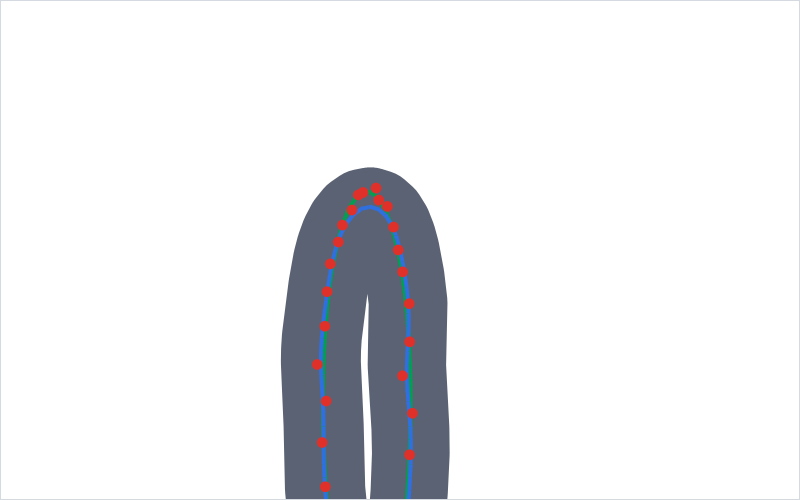

# Ink Lab — pen testing

The Ink Lab measures how Len's ink looks and behaves, not just whether it
draws. It has three parts:

- **Recordings** (`.leninput`): everything the drawing surface received while
  someone wrote. That is every pointer event, every batch of historical stylus
  samples from the Android channel, and every frame boundary with its frame
  timings, in arrival order, plus the pen and view settings
  (`app/lib/ink/lab/`).
- **Replay and metrics**: `ReplayDriver` feeds a recording frame by frame
  through the real pipeline (`InkInputController` with `StylusSampleMerger`,
  `LiveInk`, `SurfaceModel` commit). The suite (`app/test/inklab/`) measures
  each live frame and each committed stroke against what the pen really did.
  Simulated S Pen cases carry an exact ground truth (`sim/`). Real recordings
  use their raw digitiser samples as the truth.
- **The on-device Lab screen**: you write on the real pipeline, see live input
  statistics, then save, share, open and replay recordings.

## Recording on the tablet

1. Open **Settings → About** and tap the version (**Len 0.1.0**) **7 times**.
   The Ink Lab opens. It is a scratch surface: nothing is saved to your
   notebooks or synced.
2. Choose the pen with the pen menu in the app bar: stabiliser 0 / 0.4 / 1 and
   width 1.5 / 2.5 / 4. Low-latency ink and stylus-only follow the app's
   settings.
3. Write. The bar at the bottom shows:
   - the digitiser rate (Hz) and samples per frame of the latest contact;
   - mean and maximum frame build and raster times (ms);
   - the live-outline build time (ms);
   - sample and contact counts.

   On a Galaxy Tab with S Pen expect about 240 Hz at about 2 samples per frame
   (120 Hz display). About 1 sample per frame means the historical samples are
   not arriving.
4. **Save** (share icon) writes `inklab-<time>.leninput`. Desktop opens a save
   dialog, Android the share sheet (send it to Drive or mail, or save it to
   Files), and the web downloads it. A recording covers everything since the
   last **Clear**, so clear before each take. Keep takes short and focused, e.g.
   one line of cursive, a row of dots, or quick strokes with flicks.
5. **Replay** plays the current recording again in real time through the
   pipeline, with the selected pen (compare stabilisers on the same input).
   **Open** loads a `.leninput` file, switches to its pen and replays it, one
   recorded frame per real frame. The stats bar then shows the recording's own
   frame timings.

## Adding recordings to the suite

Copy the file to `app/test/inklab/recordings/` (any name, `.leninput`). The
suite picks up every file there, at the recorded stabiliser and at
stabiliser 0. With no exact truth, the raw samples are the truth: fidelity
and nub limits get 0.3 px of slack for the jitter in the truth itself.
Contacts shorter than 80 ms that start within 120 ms and 16 px of the last
lift count as bounces, not as intended strokes. Then run the suite. New
failures either point to a regression, or need an entry in
`known_failures.dart` tied to a finding below.

Two simulated recordings are committed as format samples and regression
inputs: `sim_cursive.leninput` and `sim_hooks.leninput`, the `cursive` and
`hooks` cases at the default pen. Replace them with real S Pen takes when
there are some.

## Running

From `app/` (always through `tool/heavy.sh`, one heavy job at a time):

```sh
tool/heavy.sh nix develop ..# -c bash -c 'flutter test --concurrency=4 test/inklab'
# the visual report (≈ 2 min) → build/inklab_report/index.html
tool/heavy.sh nix develop ..# -c bash -c \
  'flutter test test/inklab/report/report_test.dart --dart-define=INKLAB_REPORT=true'
```

`inklab_test.dart` has one test per metric per entry. Entries are the ten
simulated cases at stabiliser 0, 0.4 and 1, plus every recording. Real
device recordings (`recordings/real_*.leninput`, a minute or more of writing
each) take many minutes to replay through the pixel metrics, so they only run
with `--dart-define=INKLAB_REAL=true`:

```sh
tool/heavy.sh nix develop ..# -c bash -c \
  'flutter test --concurrency=4 test/inklab --dart-define=INKLAB_REAL=true'
```

Pen-engine work must pass that run too. Timing
metrics only run on `long_stroke` and recordings. Metrics listed in
`known_failures.dart` are **skipped with their finding as the reason**, so the
suite is green on the current engine. Fixing a finding means deleting its
entries; the suite then guards the fix.

The report has, per entry:
- the metrics table: ok / known / FAIL, and where (logical px) the worst value
  is;
- **final ink at 1x**: plain, then marked;
- **final ink at 4x and 16x**: around the worst spot of the most telling
  failing metric, zoom × device pixel ratio, so 1x is what the screen shows.
  Grey is ink, green the true path, red dots the raw samples, blue the
  smoothed centre line;
- a **filmstrip** of live frames: the 4 frames with the most change behind the
  tip plus evenly spread ones, then the committed stroke. Red marks pixels
  that changed behind the tip, blue changes at the tip, magenta the pop at
  pen-up;
- a **heatmap** of changes behind the tip over all frames (yellow to red, more
  frames redder; magenta: changed at pen-up);
- the **low-latency overlay sheet**: the 12 worst moments of the wet-ink
  model. Dark is Flutter now, light grey Flutter once caught up, blue the
  overlay, red ghost ink, orange gaps.

The pictures are rasterised in pure Dart (`report/picture.dart`,
`metrics/raster.dart`), so they are deterministic and need no GPU.

## Simulated S Pen (`test/inklab/sim/`)

`pen_motion.dart` describes the true motion of each case: parametric cursive
letters, loops, zigzags, a pressure swell, taps, lines, a spiral and an 8 s
stroke. `digitiser.dart` models the device:
- 240 Hz samples on a 120 Hz display at device pixel ratio 2;
- Gaussian jitter of 0.08 px and pressure noise of 0.01, 4096 pressure levels;
- 4 ms latency;
- Android batching: one `MotionEvent` per frame, the rest as historical
  samples on the stylus channel;
- a pressure spike on the up event;
- optional pen-down/up hooks and bounces.

`cases.dart` lists the ten cases.

## Metrics

"px" is logical screen px; "px²" counts physical pixels. Limits marked a/b/c
are for stabiliser 0 / 0.4 / 1, linear in between (`byStabiliser`).

| Metric | What it measures | Limit |
|---|---|---|
| `fidelity.hausdorff` | Farthest distance between the committed centre line and the true path, both ways, so shrunken loops count too | 0.5 / 1.0 / 2.0 px (+0.3 for recordings) |
| `fidelity.rms` | RMS distance from centre line to true path | 0.2 / 0.4 / 0.8 px (+0.3) |
| `fidelity.width` | Worst relative error of the ink radius against the radius the true pressure gives, away from the ends | 15 / 25 / 40 % |
| `detail.retraction` | How far cusp tips and tight bends (radius < 6 px) of the true path lie from the centre line, i.e. over-smoothing | 0.5 / 1.2 / 2.5 px |
| `smooth.edgeBump16x` | Edge bumps as seen at 16x: residual of a local parabola fit (±1.5 px) of each edge, × 16. Cusps, ends and too-tight bends are skipped | 1 px |
| `smooth.widthBump16x` | The same for the width | 1 px |
| `smooth.facet` | Kinks: residual of the turn per centre-line sample against its neighbours | 5° |
| `ends.blob` | End radius ÷ median body radius | 1.1× |
| `ends.nub` | Ink beyond the true path within 3 widths of an end (pen-down/up hooks) | 0.6 / 1.2 / 2.2 px (+0.3) |
| `ends.stray` | Committed strokes minus intended ones (bounces) | 0 |
| `ends.dotSize` | Size error of a tap's dot against the true peak pressure | 30 % |
| `temporal.behindTip` | Worst frame: physical pixels whose coverage changes by > 20 % more than one stroke width + 1 px behind the previous tip, outside the new samples | 0 px² |
| `temporal.settle` | Farthest change from the previous tip | width + 1 px (3.5 px) |
| `temporal.vanished` | Contacts drawn live but never committed (a bounce flashing) | 0 |
| `pop.pixels` | Pixels changing by > 25 % between the last live frame and the committed stroke, outside the samples that came after that frame | 2 px² |
| `pop.max` | Largest such coverage change | 50 % |
| `perf.flatness` | Median live-outline build time in the last fifth of the longest contact ÷ the first fifth, which is ≈ 1 if per-frame cost is O(1) | 2× |
| `perf.frameCost` | Median live build in the last fifth (this machine, JIT) | 1000 µs |
| `perf.commit` | Pen-up handling + committed outline | 8 ms |
| `perf.subpaths` | Sub-paths (`moveTo`s) in the last live outline; the GPU re-tessellates all of them each frame | 64 |
| `overlay.gap` | Low-latency model, Flutter 2 frames behind: pixels the caught-up ink covers that neither Flutter's current ink nor the overlay does (also reported at depths 1 and 3, no limit) | 0 px² |
| `overlay.ghost` | Overlay pixels where the caught-up ink is not, which shows as a bulge or a pop when the overlay retracts | 2 px² |

The overlay metrics use `WetInkModel`, a Dart model of
`android/.../WetInkOverlay.kt`. Keep the two in step.

## Findings (engine as of this branch)

On the current engine, 151 metric results fail across the 30 simulated
entries, and 25 more across the 4 recording entries. All of them are explained
by the eight findings below and listed in `known_failures.dart`. Everything
else passes:
- width fidelity, blobs, dot sizes, strays and commit time everywhere;
- fidelity and smoothness at stabiliser 0.4 and 1, except where the findings
  below say otherwise.

Images below come from the report (`docs/inklab/`).

### F1: ink behind the tip changes while writing

`temporal.behindTip` / `settle` fail on:
- `lines`, `hooks` and `bounces` at every stabiliser: up to 376 px² in one
  frame, changes up to 100 px behind the tip;
- `zigzag`, `pressure_swell`, `cursive`, `spiral` and `long_stroke` at 0.4
  and 1: 1–67 px², up to 19 px behind.

The cause is in `CapsuleEmitter._keySamples`. Nearly collinear runs are merged
into one capsule while the direction stays within **0.02 rad of where the run
started**. On a straight-ish stroke the last merged capsule keeps growing, and
its far end moves with every new sample. The whole edge strip then re-tilts by
a pixel row as you write. This contradicts ARCHITECTURE.md ("each capsule
depends only on its two samples, so new input only adds geometry"). Near
corners and cusps, the centre-line filter (stretch boundaries move as
reversals are found) also reshapes ink 14–19 px behind the tip (`zigzag`,
`pressure_swell`).


*`hooks@0.4`, first stroke (a 120 px line).* From the 5th tile on, red
streaks run along both edges for 30–70 px behind the tip. The last tile, the
committed stroke, is framed in magenta, with magenta along the right half of
the edge.


*The same stroke over all frames.* Yellow/red pixels line both edges over the
last ~60 % of the line. The changes are one-pixel-row steps along the whole
edge: a tilt, not a bump at the tip.

### F2: pop at pen-up

`pop.pixels` is 158 px² (`lines@0.4`), 145 px² (`lines@1`), 248 px²
(`hooks@0.4`) and 192 px² (`hooks@1`). `pop.max` reaches 88–100 % (`hooks`).

The committed outline is built with `complete: true`: hooks trimmed, ends
levelled, the merge runs re-decided. It differs from the last live frame along
the whole edge, not just at the tip. The magenta strips in the two images
above are this pop.

### F3: pen-down/up hooks are not trimmed

`ends.nub` is 2.99–3.01 px on `hooks` at every stabiliser. The limits are 0.6
/ 1.2 / 2.2 px. The simulated flicks are 2.5–3 px over three samples, turning
back by about 115–125°. The hook trimmer misses them, and they are drawn as
small curls. Against raw samples (`rec:sim_hooks`) the flick is only half
drawn (`fidelity.hausdorff` 1.76 px).


*`hooks@0.4` at 16x, end of "uue".* The up-flick at the right is drawn as a
3 px hooked tail rising from the baseline: the true path (green, under the
blue centre line) and the raw samples (red) go there too, but it should not
be ink.

### F4: bounces flash

`temporal.vanished` = 2 on `bounces` at every stabiliser: both 40 ms
re-contacts are drawn live for a few frames. The bounce filter only drops them
at pen-up (`ends.stray` passes), so they flash and disappear.

### F5: stabiliser 0 smooths nothing

At stabiliser 0, `OutlineSpec.positionSigma` is `2 × streamline × …` = **0**,
so digitiser jitter goes straight into the ink.

| Metric | Range at stabiliser 0 | Limit |
|---|---|---|
| `smooth.edgeBump16x` | 1.0–2.3 px (6 cases) | 1 px |
| `smooth.facet` | 6.5–21.8° (7 cases) | 5° |

ARCHITECTURE.md says that "at stabiliser 0 the filter only removes sub-pixel
noise". It removes none.




*`cursive` loop tops at 16x, stabiliser 0 (first) and 0.4 (second).* At 0
both edges are visibly polygonal: straight facets with kinks following every
raw sample (red dots), bumps of about a tenth of a pixel that are plain at
16x. At 0.4 the same loop has smooth, round edges, and the centre line (blue)
runs through the middle of the sample scatter.

### F6: live cost grows with stroke length

`perf.flatness` is 8.5–8.9× on `long_stroke`: the live outline takes 132 µs
early and 1126 µs at 1108 points (stabiliser 0.4), so `perf.frameCost` is
1.1–1.2 ms here, on desktop JIT. It is 4–6.6× on the 2–3 s cases and
recordings. `perf.subpaths` at the end of `long_stroke` is **2665** (0),
**1869** (0.4) and **1043** (1). The two-word `cursive` case already has 340.

`LiveInkPainter` rebuilds the whole live stroke every frame, and every capsule
is its own sub-path, which the GPU re-tessellates each frame. That is most
likely the slowness felt on the tablet: a few times slower CPU than this
machine, plus thousands of sub-paths per frame late in a long stroke. The
docs' "a 1000-point stroke builds in well under a millisecond" does not hold
here. Fix direction: freeze the settled part of the live stroke into a
picture or raster, and rebuild only the tail.

### F7: the wet-ink overlay can't match Flutter's ink

`overlay.ghost` is 6–22 px² on every case and stabiliser. `overlay.gap` is
2–13 px² on `hooks`, `pressure_swell` and `zigzag` at 0.4 and 1, and on
`cursive` and `long_stroke` at 1. The overlay (`WetInkOverlay.kt`, modelled
by `WetInkModel`) draws raw-sample capsules:
- pressure EMA keeping 0.65, while Dart's `PressureFilter` keeps 0.4;
- no stabiliser, causal radius smoothing, slope limit, minimum spacing, hook
  trimming or tapers.

Its tip therefore sticks out of the ink Flutter draws when it catches up.


*`hooks@0.4`, worst overlay moments.*
- Almost every tile has a red rim of ghost ink, 1–3 physical px, around the
  front of the blue overlay blob: it is wider and further ahead than Flutter's
  caught-up ink.
- In tiles 3–5 the overlay draws the up-flick that Flutter later trims, a
  whole red patch.
- Tiles 2 and 4 have an orange gap strip along the stroke's edge: the overlay
  has retracted while Flutter's catching-up frame has moved that edge (F1).

### F8: tips cut short at stabiliser 0

`detail.retraction` and `fidelity.hausdorff` are 0.54–0.56 px on `zigzag@0`
and `long_stroke@0`, against a 0.5 px limit. Cusp tips and tight loop tops
end slightly inside the true path even without smoothing. This is marginal,
but it means the stabiliser-0 limit cannot be met as is.


*A `zigzag@0` tip at 16x.* The edges are faceted (F5). The ink's apex is
rounded slightly below the topmost raw sample and the green truth.

### Not failures, but worth knowing

- Fidelity, width and detail pass at the default stabiliser 0.4 on every case.
  The default pen is accurate; the problems are temporal (F1, F2), the ends
  (F3, F4) and cost (F6).
- At 16x on `long_stroke@0.4`, slowly curving edges sometimes show long
  straight stretches meeting at a faint bend: merged capsules (the same
  0.02 rad rule as F1). They stay below the facet limit.
