# Ink Lab — pen testing

The Ink Lab measures how Len's ink looks and behaves, not just whether it
draws. It has three parts:

- **Recordings** (`.leninput`): everything the drawing surface received while
  someone wrote. That is every pointer event, every batch of historical stylus
  samples from the Android channel, and every frame boundary with its frame
  timings, in arrival order, plus the pen and view settings
  (`app/lib/ink/lab/`).
- **Replay and metrics**: `ReplayDriver` feeds a recording frame by frame
  through the real pipeline (`InkInputController` with `StylusSampleMerger`,
  `LiveInk`, `SurfaceModel` commit). The suite (`app/test/inklab/`) measures
  each live frame and each committed stroke against what the pen really did.
  Simulated S Pen cases carry an exact ground truth (`sim/`). Real recordings
  use their raw digitiser samples as the truth.
- **The on-device Lab screen**: you write on the real pipeline, see live input
  statistics, then save, share, open and replay recordings.

## Recording on the tablet

1. Open **Settings → About** and tap the version (**Len 0.1.0**) **7 times**.
   The Ink Lab opens. It is a scratch surface: nothing is saved to your
   notebooks or synced.
2. Choose the pen with the pen menu in the app bar: stabiliser 0 / 0.4 / 1 and
   width 1.5 / 2.5 / 4. Low-latency ink and stylus-only follow the app's
   settings.
3. Write. The bar at the bottom shows:
   - the digitiser rate (Hz) and samples per frame of the latest contact;
   - mean and maximum frame build and raster times (ms);
   - the live-outline build time (ms);
   - sample and contact counts.

   On a Galaxy Tab with S Pen expect about 240 Hz at about 2 samples per frame
   (120 Hz display). About 1 sample per frame means the historical samples are
   not arriving.
4. **Save** (share icon) writes `inklab-<time>.leninput`. Desktop opens a save
   dialog, Android the share sheet (send it to Drive or mail, or save it to
   Files), and the web downloads it. A recording covers everything since the
   last **Clear**, so clear before each take. Keep takes short and focused, e.g.
   one line of cursive, a row of dots, or quick strokes with flicks.
5. **Replay** plays the current recording again in real time through the
   pipeline, with the selected pen (compare stabilisers on the same input).
   **Open** loads a `.leninput` file, switches to its pen and replays it, one
   recorded frame per real frame. The stats bar then shows the recording's own
   frame timings.

## Adding recordings to the suite

Copy the file to `app/test/inklab/recordings/` (any name, `.leninput`). The
suite picks up every file there, at the recorded stabiliser and at
stabiliser 0. With no exact truth, the raw samples are the truth: fidelity
and nub limits get 0.3 px of slack for the jitter in the truth itself.
Contacts shorter than 80 ms that start within 120 ms and 16 px of the last
lift count as bounces, not as intended strokes. Then run the suite. New
failures either point to a regression, or need an entry in
`known_failures.dart` tied to a finding below.

Two simulated recordings are committed as format samples and regression
inputs: `sim_cursive.leninput` and `sim_hooks.leninput`, the `cursive` and
`hooks` cases at the default pen. Replace them with real S Pen takes when
there are some.

## Running

From `app/` (always through `tool/heavy.sh`, one heavy job at a time):

```sh
tool/heavy.sh nix develop ..# -c bash -c 'flutter test --concurrency=4 test/inklab'
# the visual report (≈ 2 min) → build/inklab_report/index.html
tool/heavy.sh nix develop ..# -c bash -c \
  'flutter test test/inklab/report/report_test.dart --dart-define=INKLAB_REPORT=true'
```

`inklab_test.dart` has one test per metric per entry. Entries are the ten
simulated cases at stabiliser 0, 0.4 and 1, plus every recording. Real
device recordings (`recordings/real_*.leninput`, a minute or more of writing
each) take many minutes to replay through the pixel metrics, so they only run
with `--dart-define=INKLAB_REAL=true`:

```sh
tool/heavy.sh nix develop ..# -c bash -c \
  'flutter test --concurrency=4 test/inklab --dart-define=INKLAB_REAL=true'
```

Pen-engine work must pass that run too. Timing metrics only run on
`long_stroke` and recordings. Metrics listed in `known_failures.dart` are
**skipped with their finding as the reason**. The list is **empty**: the
engine passes every metric on every entry, real recordings included, so any
failure is a regression (or needs a new finding, with evidence, before an
entry may be added).

Tools for working on the engine (opt-in tests):

```sh
# every metric of every entry as a table (≈ 4 min with the real recordings),
# "!!" marks failures
tool/heavy.sh nix develop ..# -c bash -c 'flutter test test/inklab/tools/table_test.dart \
  --dart-define=INKLAB_TABLE=true --dart-define=INKLAB_REAL=true \
  [--dart-define=INKLAB_ONLY=<regex on entry names>]'
# the Kotlin overlay model against the Dart one (needs only nix)
tool/wet_ink_check/check.sh
```

The report has, per entry:
- the metrics table: ok / known / FAIL, and where (logical px) the worst value
  is;
- **final ink at 1x**: plain, then marked;
- **final ink at 4x and 16x**: around the worst spot of the most telling
  failing metric, zoom × device pixel ratio, so 1x is what the screen shows.
  Grey is ink, green the true path, red dots the raw samples, blue the
  smoothed centre line;
- a **filmstrip** of live frames: the 4 frames with the most change behind the
  tip plus evenly spread ones, then the committed stroke. Red marks pixels
  that changed behind the tip, blue changes at the tip, magenta the pop at
  pen-up;
- a **heatmap** of changes behind the tip over all frames (yellow to red, more
  frames redder; magenta: changed at pen-up);
- **pen-down close-ups** (`report/pen_down.dart`): for a few contacts
  (bounces first, magenta frame), the frame before pen-down and each frame
  after it, 28 px around where the pen landed at 8×: ink committed before
  (light grey), the contact's ink (grey, black once committed), its raw
  samples so far (red, the landing one ringed) and the pen (black ring).
  Ink must be under the ring from the second tile on;
- the **low-latency overlay sheet**: the 12 worst moments of the wet-ink
  model. Dark is Flutter now, light grey Flutter once caught up, blue the
  overlay, red ghost ink, orange gaps.

The pictures are rasterised in pure Dart (`report/picture.dart`,
`metrics/raster.dart`), so they are deterministic and need no GPU.

## Simulated S Pen (`test/inklab/sim/`)

`pen_motion.dart` describes the true motion of each case: parametric cursive
letters, loops, zigzags, a pressure swell, taps, lines, a spiral and an 8 s
stroke. `digitiser.dart` models the device:
- 240 Hz samples on a 120 Hz display at device pixel ratio 2;
- Gaussian jitter of 0.08 px and pressure noise of 0.01, 4096 pressure levels;
- 4 ms latency;
- Android batching: one `MotionEvent` per frame, the rest as historical
  samples on the stylus channel;
- a pressure spike on the up event;
- optional pen-down/up hooks and bounces.

`cases.dart` lists the ten cases.

## Metrics

"px" is logical screen px; "px²" counts physical pixels. Limits marked a/b/c
are for stabiliser 0 / 0.4 / 1, linear in between (`byStabiliser`).

| Metric | What it measures | Limit |
|---|---|---|
| `fidelity.hausdorff` | Farthest distance between the committed centre line and the true path, both ways, so shrunken loops count too | 0.5 / 1.0 / 2.0 px (+0.3 for recordings) |
| `fidelity.rms` | RMS distance from centre line to true path | 0.2 / 0.4 / 0.8 px (+0.3) |
| `fidelity.width` | Worst relative error of the ink radius against the radius the true pressure gives, away from the ends | 15 / 25 / 40 % |
| `detail.retraction` | How far cusp tips and tight bends (radius < 6 px) of the true path lie from the centre line, i.e. over-smoothing | 0.5 / 1.2 / 2.5 px |
| `smooth.edgeBump16x` | Edge bumps as seen at 16x: residual of a local parabola fit (±1.5 px) of each edge, × 16. Cusps, ends and too-tight bends are skipped | 1 px |
| `smooth.widthBump16x` | The same for the width | 1 px |
| `smooth.facet` | Kinks: residual of the turn per centre-line sample against its neighbours | 5° |
| `ends.blob` | End radius ÷ median body radius | 1.1× |
| `ends.nub` | Ink beyond the true path within 3 widths of an end (pen-down/up hooks) | 0.6 / 1.2 / 2.2 px (+0.3) |
| `ends.stray` | Committed strokes minus intended ones (bounces) | 0 |
| `ends.dotSize` | Size error of a tap's dot against the true peak pressure | 30 % |
| `start.distance` | How far the pen was from ink when ink first showed: the raw samples' travel during frames without ink, else the distance from where the pen landed to the first frame's ink | 0.5 px |
| `start.delay` | Frames from the first frame built after pen-down to the first frame with the contact's ink | 1 frame |
| `temporal.behindTip` | Worst frame: physical pixels whose coverage changes by > 20 % more than one stroke width + 1 px behind the previous tip, outside the new samples (and, once per contact, the trimmed pen-down hook, see F9) | 0 px² |
| `temporal.settle` | Farthest change from the previous tip (same exception) | width + 1 px (3.5 px) |
| `temporal.vanished` | Intended contacts drawn live but never committed | 0 |
| `temporal.bounceFlash` | How long a bounce shows (it is drawn while it touches, < 80 ms, and dropped at its lift) | 100 ms |
| `pop.pixels` | Pixels changing by > 25 % between the last live frame and the committed stroke, outside the samples that came after that frame | 2 px² |
| `pop.max` | Largest such coverage change | 50 % |
| `perf.flatness` | Median live-outline build time in the last fifth of the longest contact ÷ the first fifth (counted from 5 frames after part of the stroke became final: the first frames, a few points of tail, are cheaper), which is ≈ 1 if per-frame cost is O(1) | 2× |
| `perf.frameCost` | Median live build in the last fifth (this machine, JIT) | 1000 µs |
| `perf.commit` | Pen-up handling + committed outline | 8 ms |
| `perf.subpaths` | Sub-paths (`moveTo`s) in the last live outline; the GPU re-tessellates all of them each frame | 64 |
| `overlay.gap` | Low-latency model, Flutter 2 frames behind: pixels the caught-up ink covers that neither Flutter's current ink nor the overlay does (also reported at depths 1 and 3, no limit) | 0 px² |
| `overlay.ghost` | Overlay pixels where the caught-up ink is not, which shows as a bulge or a pop when the overlay retracts | 2 px² |

The overlay metrics use `WetInkModel` (`lib/ink/lab/wet_ink_model.dart`).
`android/.../WetInkModel.kt` is its line-for-line port, which the overlay
draws with; `tool/wet_ink_check/check.sh` feeds both every case and
recording and compares their answers (they agree to 1e-15). A moment at
depth *d* is the screen when Flutter's frame *k* is shown, *d* − 1 frame
intervals after it was built (in time: after a lift the app idles and the
next recorded frames come much later).

## Findings: the old engine, and the new one

The suite was built against the capsule engine (`CapsuleEmitter`, a
whole-stroke rebuild every frame). On it, 111 metric results failed across
the 30 simulated entries (with today's metric definitions; 151 with the
first ones) and 25 on the two simulated recordings, explained by eight
findings, F1–F8 below. The new engine (`StrokeShaper` + `RibbonEmitter` +
`LiveStrokeBuilder`, see ARCHITECTURE "Ink rendering") was built against
them: **every metric now passes on every entry**, including the two real S
Pen recordings, and `known_failures.dart` is empty. F9 (late ink at
pen-down) was found on the new engine and fixed with the `start.*`
metrics; the table below is from before F9, which changed some values a
little (see F9).

Worst value per group of entries, old → new (✗ = entries failing; the
recordings were added with the new engine, so they have no "before"; timings
are desktop JIT and vary by ±50 % between runs):

| Metric | sim @0 | sim @0.4 | sim @1 | recordings (new) |
|---|---|---|---|---|
| `fidelity.hausdorff` | 2.99 (3✗) → 0.355 px | 2.99 (1✗) → 0.474 | 3.01 (1✗) → 0.797 | 0.512 |
| `fidelity.rms` | 0.356 (1✗) → 0.066 px | 0.354 → 0.067 | 0.428 → 0.112 | 0.054 |
| `fidelity.width` | 9.1 → 7.5 % | 19.4 → 19.5 | 21.0 → 21.5 | 22.9 |
| `detail.retraction` | 0.555 (2✗) → 0.385 px | 0.932 → 0.472 | 1.54 → 0.795 | 0.49 |
| `smooth.edgeBump16x` | 2.26 (6✗) → 0.60 px | 0.918 → 0.328 | 0.341 → 0.164 | 0.934 |
| `smooth.facet` | 21.8° (7✗) → 2.3° | 1.07 → 0.84 | 0.80 → 0.37 | 3.44 |
| `ends.nub` | 2.99 (1✗) → 0.30 px | 2.99 (1✗) → 0.30 | 3.01 (1✗) → 0.30 | 0.28 |
| `temporal.behindTip` | 200 (3✗) → 0 px² | 376 (5✗) → 0 | 273 (8✗) → 0 | 0 |
| `temporal.settle` | 88.8 (3✗) → 0 px | 100 (5✗) → 0 | 76.8 (8✗) → 0 | 0 |
| `temporal.vanished` | 2 (1✗) → 0 | 2 (1✗) → 0 | 2 (1✗) → 0 | 0 |
| `pop.pixels` | 0 → 0 px² | 248 (2✗) → 0 | 192 (2✗) → 0 | 0 |
| `pop.max` | 0 → 0 % | 88 (1✗) → 0 | 100 (1✗) → 0 | 0 |
| `perf.flatness` | 5.5 (1✗) → 1.6× | 8.7 (1✗) → 0.7 | 8.6 (1✗) → 1.0 | 1.5 |
| `perf.frameCost` | 1292 (1✗) → 42 µs | 1135 (1✗) → 54 | 602 → 30 | 156 |
| `perf.commit` | 2.7 → 1.9 ms | 2.4 → 2.8 | 1.6 → 2.2 | 1.5 |
| `perf.subpaths` | 2665 (1✗) → 22 | 1869 (1✗) → 24 | 1043 (1✗) → 21 | 4 |
| `overlay.gap` | 0 → 0 px² | 11 (3✗) → 0 | 13 (5✗) → 0 | 0 |
| `overlay.ghost` | 22 (10✗) → 0 px² | 21 (10✗) → 0 | 21 (10✗) → 0 | 0 |

Blobs (≤ 1.09×), strays (0), dot sizes (22.5 %) and width bumps (< 0.02 px)
passed before and still do. The overlay at pipeline depth 1 has no gap or
ghost anywhere; at depth 3 (one frame deeper than the overlay assumes) the
only gap is 5 px² on `real_spen_01`.

Images: the old engine's in `docs/inklab/before/`, the new one's in
`docs/inklab/` (from the report).

### F1 (resolved): ink behind the tip changed while writing

Was: `temporal.behindTip` up to 376 px², changes up to 100 px behind the tip
(`lines`, `hooks`, `bounces` at every stabiliser; most cases at 0.4 and 1).
Merged capsule runs kept growing, so whole edges re-tilted, and the
centre-line filter reshaped ink near corners as reversals were found.

Now: every stage of `StrokeShaper` has a fixed reach (resampling from the
start, a *finite* low-pass kernel, corners decided from samples a fixed
distance ahead, causal radii), and `RibbonEmitter` decides runs from at most
two samples ahead and cuts them at fixed indices. Ink beyond that reach is
final and frozen. `behindTip` and `settle` are 0 on every entry, the
heatmaps are empty.


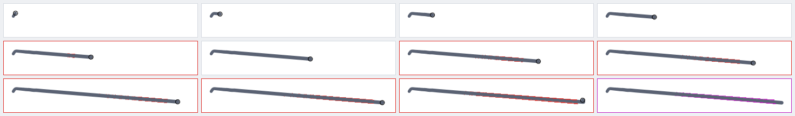

*`hooks@0.4`, first stroke, before and now.* Before, red streaks ran along
both edges behind the tip and the committed frame had magenta along the
edge (F2). Now no tile has a red, blue-behind-the-tip or magenta pixel.

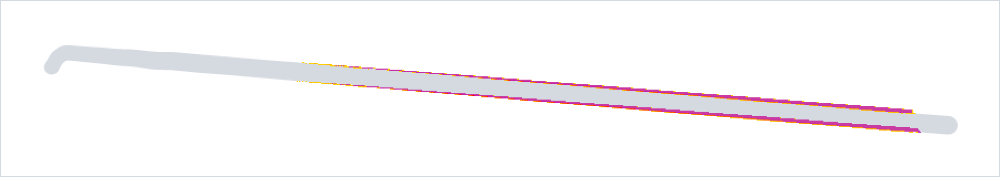


### F2 (resolved): pop at pen-up

Was: `pop.pixels` up to 248 px², `pop.max` 100 %: the committed outline was
built anew (hooks trimmed, ends levelled, runs re-merged) and differed along
the whole edge. Now the commit continues the live builder: it rolls back to
a checkpoint that does not depend on the last samples and only redoes the
end, so the committed stroke *is* the last live frame plus its end. 0
everywhere.

### F3 (resolved): pen-down/up hooks were not trimmed

Was: `ends.nub` 3 px on `hooks`. Now `HookFinder` trims a short end piece
that meets the body at a local kink. The start is decided once, from the
first few screen px (since F9 the stroke shows before that, and a trimmed
hook's ink goes once); the end at pen-up. `ends.nub` ≤ 0.3 px everywhere.

The rules were tuned against false positives too: a hook is at most 3 px
(start) / 4 px (end) on screen whatever the pen (it is the hand's motion;
first scaled with the width, it ate the top of an "o" and the curl of an "s"
written with a 4 px pen, see `test/hooks_test.dart`), and most of its turn
must happen within a short reach of the kink, measured over at least two
samples each way (a fast curve's single-sample jitter is not a kink). A
sharp kink in the first 3 px is still trimmed even when intended (the
specimen's cursive "r" lead-in, a fraction of a pixel at 1×).

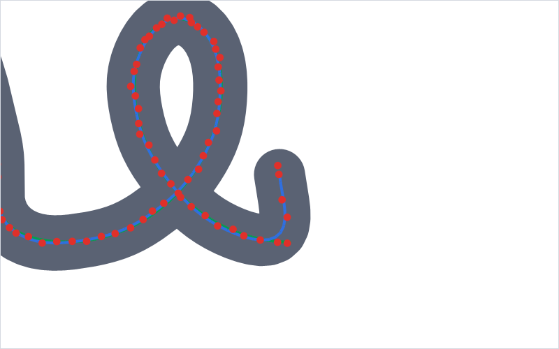
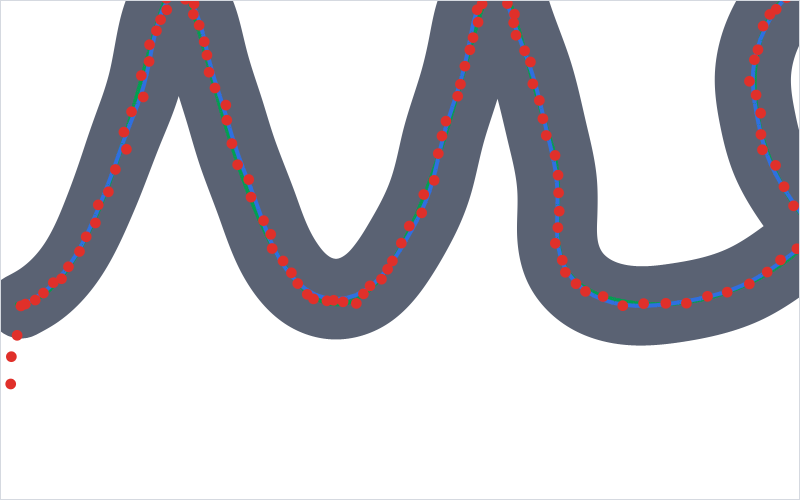

### F4 (resolved): bounces flashed

Was: `temporal.vanished` 2 on `bounces`. Then a contact that started right
after and next to a lift was held back while it could still be a bounce,
and every contact until its pen-down hook was decided, so a bounce was
never drawn. That held back nearly every stroke of fast handwriting, so
since F9 a bounce shows while it touches (< 80 ms, `temporal.bounceFlash`
25 ms on `bounces`) and is dropped at its lift; it is still never
committed (`ends.stray` 0).

### F5 (resolved): stabiliser 0 smoothed nothing

Was: σ = 0 at stabiliser 0, `edgeBump16x` up to 2.3 px and `facet` up to
21.8°. Now σ = (0.7 + 0.8 × stabiliser) screen px (more for wide pens), in
*screen* units: the stroke's unit is estimated from its point spacing, so
strokes written zoomed in are smoothed as finely as they were seen. At
stabiliser 0: `edgeBump16x` ≤ 0.6 px and `facet` ≤ 2.3° on the simulated
cases, 0.93 px and 3.4° on the real recordings.


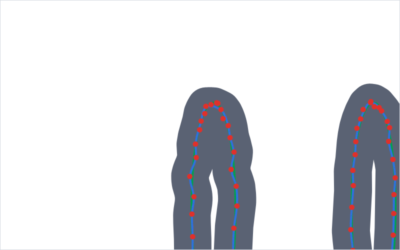

*`cursive@0` loop top at 16x.* Before, polygonal edges with a kink at every
raw sample; now smooth edges with the centre line through the middle of the
sample scatter.

### F6 (resolved): live cost grew with the stroke's length

Was: `perf.frameCost` 1.1–1.3 ms late in the 8 s stroke, `flatness` 8.7×,
up to 2665 sub-paths. Now only the tail is rebuilt (`LiveStrokeBuilder`):
30–60 µs on the long stroke, flat (0.7–1.6×), 21–24 sub-paths; the real
recordings 57–156 µs, 2–4 sub-paths.

### F7 (resolved): the wet-ink overlay could not match Flutter's ink

Was: `overlay.ghost` 6–22 px² everywhere and gaps at 0.4 and 1: the overlay
drew raw-sample capsules with its own pressure filter. Now the overlay
applies the outline's own rules (`WetInkModel`, ported to Kotlin, see
ARCHITECTURE "Low-latency ink"), including the position smoothing, and
retracts only behind what Flutter has presented. 0 everywhere.


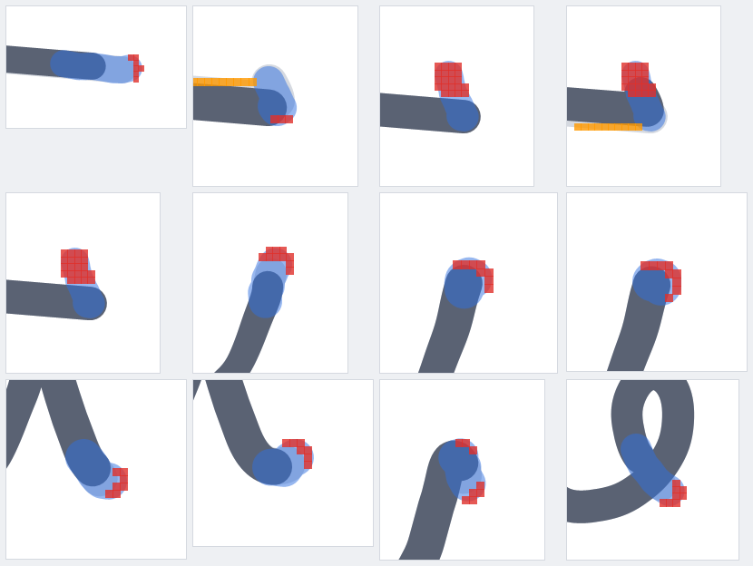

*`hooks@0.4`, worst overlay moments.* Before, red ghost rims around the
overlay's tip and orange gaps; now the overlay (blue) lies exactly on the ink
Flutter draws next (light grey), with no red or orange.

### F8 (resolved): tips cut short at stabiliser 0

Was: `detail.retraction` 0.55 px on `zigzag@0` and `long_stroke@0`. Now
corners are found on the resampled line and each stretch ends exactly at
its corner sample (the low-pass is continued past it by a pinned quadratic
fit), so tips stay put: ≤ 0.39 px at stabiliser 0.

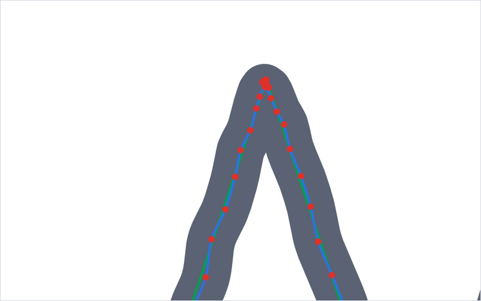


### F9 (resolved): ink appeared late at pen-down

User report (S Pen): "the pen takes too much distance from when I put
pressure down to start drawing". Measured with `start.distance` /
`start.delay` (added for it):

| | sim cases (worst per case) | real recordings (worst) | real (median contact) |
|---|---|---|---|
| before: pen travel before ink | 1.6 (taps) – 13.2 px | 20.9–26.4 px | 8.0–8.2 px |
| before: frames to first ink | 4–38 | 7–10 | 2–4 |
| now | 0 px, 0 frames | 0 px, 0 frames | 0 px, 0 frames |

Cause: a contact was shown only once (1) it could no longer be a bounce
(`BounceFilter.mightBounce`: starting within 120 ms and 16 px of the last
lift, the contact stayed hidden until it lasted 80 ms or travelled 3 px:
in fast handwriting nearly every stroke), and (2) its start was final:
≥ 9 points (to estimate the stroke's zoom from its point spacing), the
pen-down hook decided (≤ 5 px of travel) and the first smoothing window
final. All three held the ink back, and once shown it appeared all at once
behind the nib.

Now (latency beats purity):
- **Ink from the first sample.** The controller adds every point to the
  live stroke at once; the first frame after pen-down shows a dot under the
  nib, and the stroke grows from exactly where the pen landed.
- **The zoom is recorded, not estimated**: `StrokeStyle.unit` (1 / zoom at
  pen-down; synced as `u`). The estimate from the first 9 points was
  20–60 % off on the simulated cases and 0.6–2.9× on the real recordings,
  so switching to it after 9 points would have changed the whole start;
  smoothing now happens at the zoom the stroke was really written at
  (which changes the committed ink a little, see below).
- **The pen-down hook is trimmed retroactively.** Until `HookFinder` can
  decide (≤ 5 px of travel) the shaper's line is provisional: from the
  first sample, nothing final. If it finds a hook, the hook's ink (≤ 3 px,
  under the nib) disappears once, 1–6 frames after landing; otherwise
  nothing changes (provisional and decided lines are identical). The rules
  were kept: they trim 12 of 58 strokes on `real_spen_01` and 3 of 19 on
  `real_spen_02` (≤ 2.7 px each), all visibly flicks in the pen-down
  close-ups, and loosening them would bring back the nubs of F3.
  `temporal.behindTip` / `settle` exempt pixels within the reach of new
  samples (one width + 1.5 px) of the trimmed hook's points, in the one
  frame where the start moves (a second start change would count). Without
  it `hooks` measured 11 px², 5.0 px away (the trim itself), and nothing
  else changed behind the tip anywhere.
- **Bounces** show while they touch and are dropped at the lift (F4).
- **The overlay begins at pen-down** and decides the pen-down hook itself
  with the outline's rules (`WetInkShape.hookStart`); while Flutter's
  frame still shows a hook the model has trimmed, it draws the whole start
  as it is now (otherwise the trimmed start's cap, 0.3 px beyond
  Flutter's provisional smoothed corner, was a 1 px² gap on
  `real_spen_02@1`). It also follows Flutter's dot rule (a line shorter
  than half its width is a dot of the contact's largest radius; drawing a
  capsule there was a 56 px² ghost at depth 1 on `real_spen_01`). Overlay
  gap and ghost stay 0 at depths 1 and 2 everywhere.
- **Corners at the tip.** With the recorded zoom, `real_spen_01@0` showed
  how fragile picking the corner by the sharpest turn was: retraction at
  one cusp ranged 0.47–0.78 px as the resampling phase moved. The corner
  is now the run's sample furthest along the incoming direction:
  0.34–0.48 px over the same range, and `detail.retraction` ≤ 0.39 / 0.39
  / 0.58 px (sim @0 / 0.4 / 1, was 0.39 / 0.47 / 0.80) and 0.36 px on the
  recordings (was 0.49).

Other changes from smoothing at the true zoom (worst per group, old → new;
all within limits): `smooth.edgeBump16x` 0.60 → 0.71 / 0.33 → 0.57 /
0.16 → 0.38 px on the simulated cases (σ was inflated by the 1.2–1.7×
unit estimate there; recordings unchanged at 0.93), `smooth.facet`
2.3 → 3.0° / 0.84 → 0.95° / 0.37 → 0.43°, `fidelity.hausdorff`
0.36 → 0.30 / 0.47 → 0.39 / 0.80 → 0.59 px and 0.51 → 0.46 px on the
recordings.

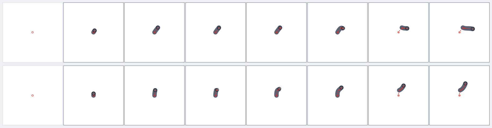

*`hooks@0.4` at pen-down.* Ink under the nib from the first frame; in the
seventh tile the 2.7 px hook is trimmed (the start moves to the kink).

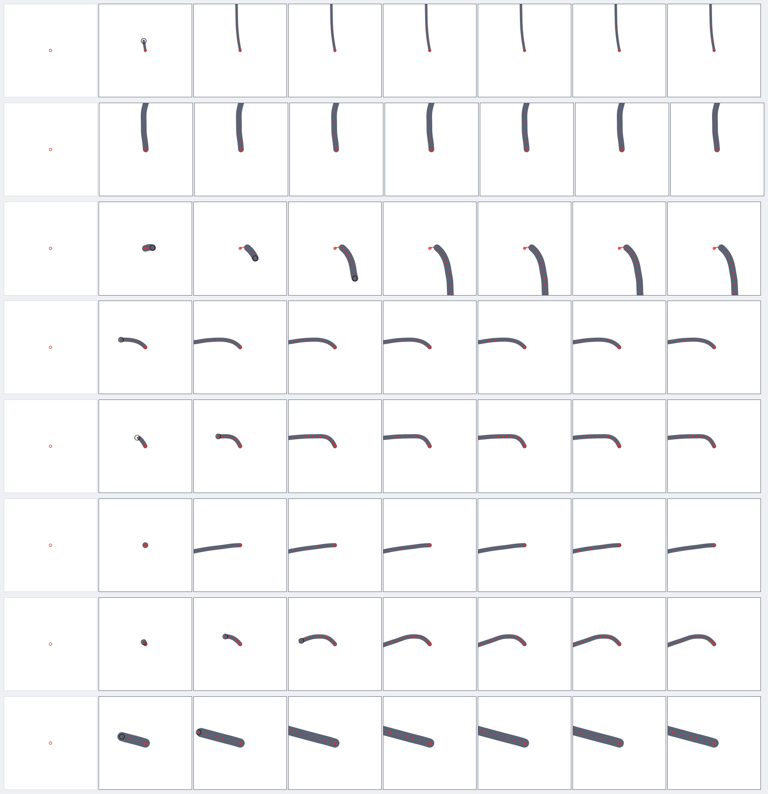

*`real_spen_02@1` at pen-down.* Every stroke starts under the ring in the
first frame; the third row is a pen-down flick, trimmed in its second
frame.

### Real S Pen recordings

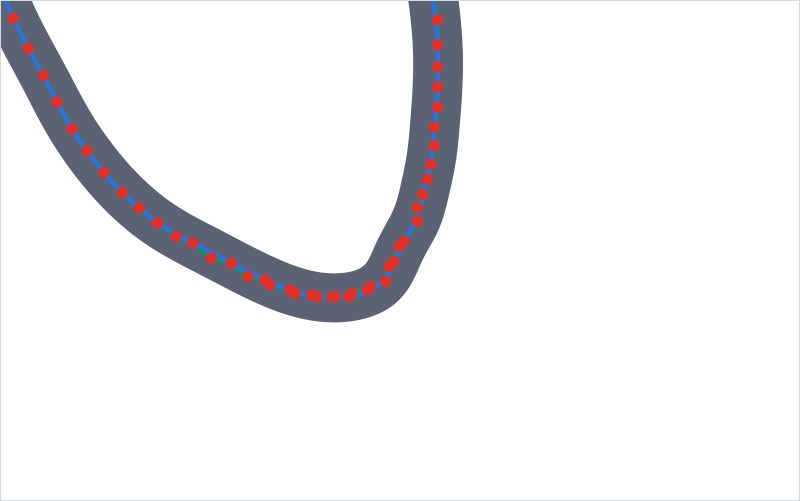

*`real_spen_01@0` at 16x, the worst edge bump.* The raw samples (red)
themselves kink there; at stabiliser 0 the ink follows them, smoothly.

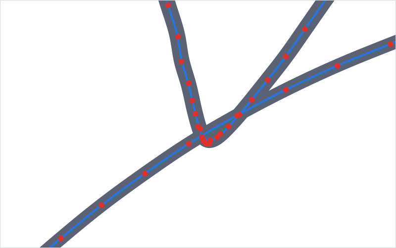

*`real_spen_02@1` at 16x, the worst edge bump.* A small loop the pen really
made at the bottom of a sharp turn.

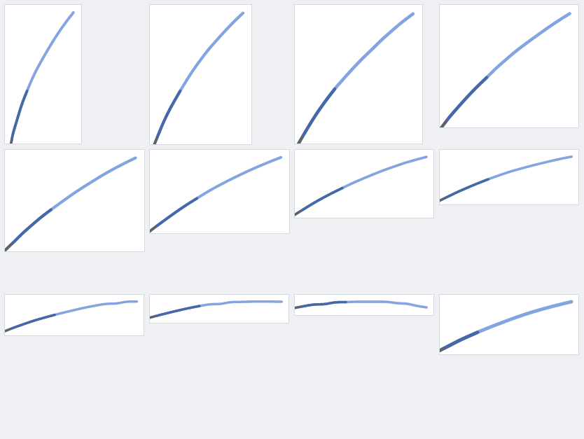

*`real_spen_02@1`, worst overlay moments.* No ghost, no gap.

### Not failures, but worth knowing

- `fidelity.width` is 15–23 % at stabilisers 0.4 and 1 (limits 25 / 40 %),
  as with the old engine: the stabiliser also smooths the width (the radius
  smoothing length is 0.5 + 6 × stabiliser widths), so quick pressure
  changes are evened out by design.
- The real recordings are rougher than the simulated pen (`edgeBump16x`
  0.93 px and `facet` 3.4° at stabiliser 0, limits 1 px and 5°): real
  hand motion and digitiser noise, which stabiliser 0 is meant to keep.
- Timings are this desktop's JIT; the tablet is a few times slower. The
  numbers that matter are the shape: per-frame cost flat with length, and
  pen-up no more than a few frames' work.

## Low-latency ink: default

**Off by default, for now.** The model says the overlay is right: no gap or
ghost at pipeline depths 1 and 2 on any case or recording, 5 px² once at
depth 3, and the Kotlin model agrees with the measured Dart model to 1e-15.
But the Kotlin overlay was rewritten here and has not yet run on a tablet:
the model checks its geometry and timing rules, not the front-buffer
rendering, the surface's z-order, or its cost per `MotionEvent` on a tablet
CPU, and it is still not clipped to the canvas (a tip dragged under a toolbar
shows above it for a frame or two). Switch it on in Settings → Input; if it
looks identical to Flutter's ink and feels faster, turning it on by default
is a one-line change (`SettingsRepository.lowLatencyInk`).
